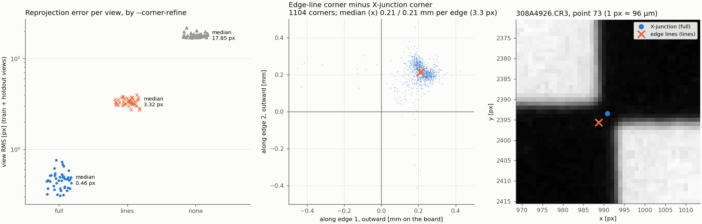
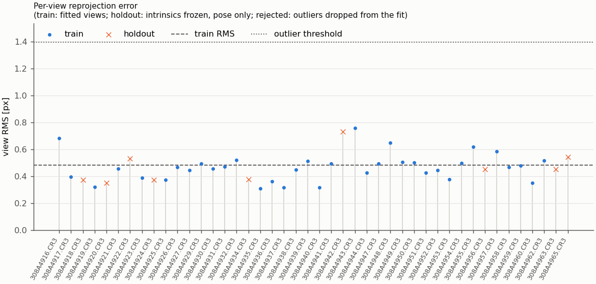
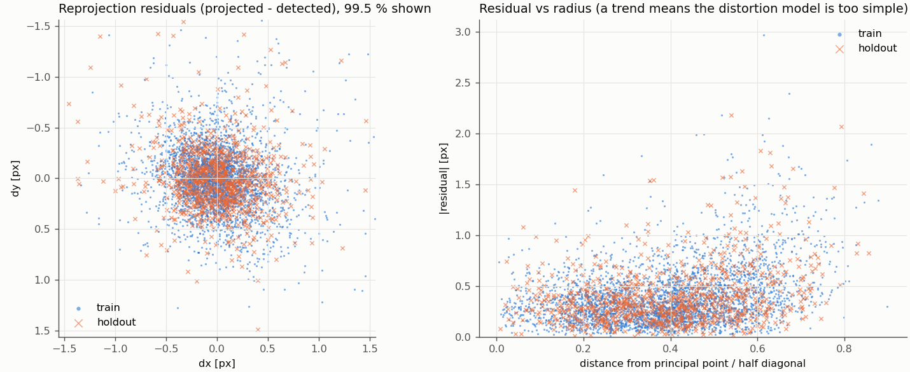
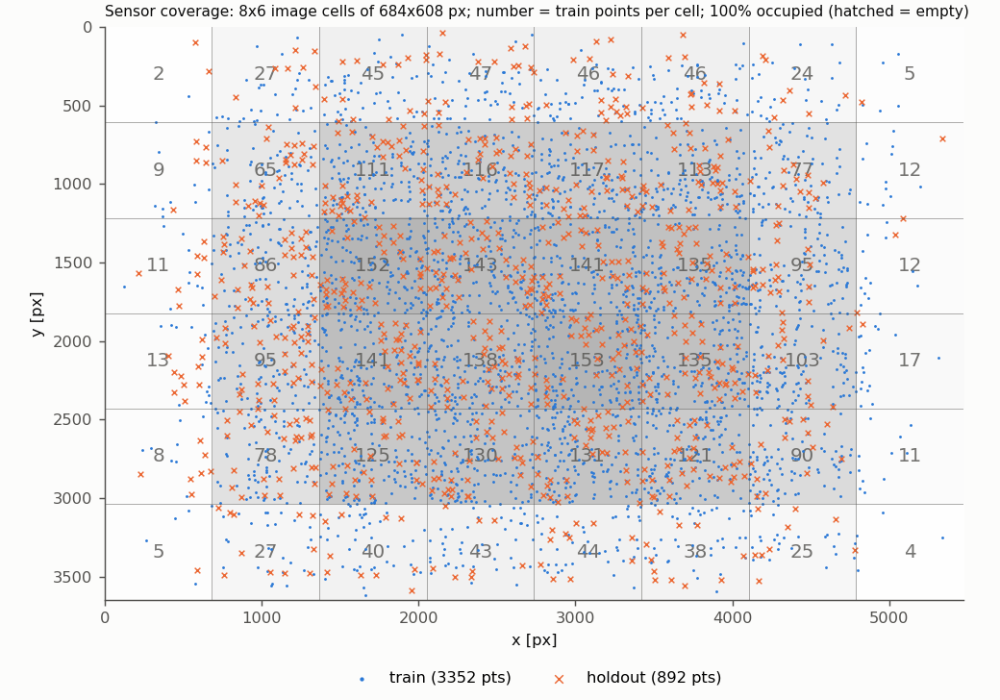
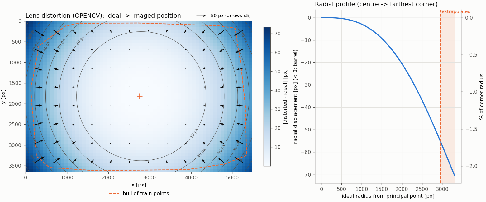
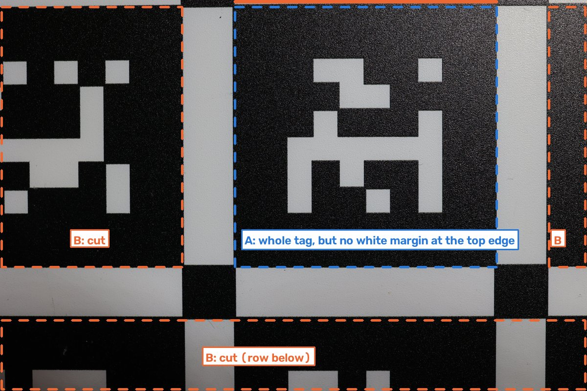

# Metric photogrammetry for medical phantoms

**Context: this study is carried out in relation to minimally invasive surgery
(MIS) and robot-assisted surgery (RAS)**, e.g. laparoscopic TAPP hernia repair
and, longer term, microsurgery on nerves.

Goal: reconstruct real objects (simple shapes first, surgical phantoms later) as
**metric 3D meshes placed in a defined reference frame**, and **quantify the
error** in shape, scale and placement. The output serves as a ground truth
(with stated uncertainty) for related research, e.g. stereo-endoscope
reconstruction, and may later be registered to CT.

## Contents

- [1. Why photogrammetry](#1-why-photogrammetry)
- [2. Pipeline](#2-pipeline)
- [3. Tooling decisions](#3-tooling-decisions)
  - [Compute presets](#compute-presets)
- [4. Scene and reference frame](#4-scene-and-reference-frame)
- [5. Capture protocol (cm–dm scale)](#5-capture-protocol-cmdm-scale)
  - [Current camera: Canon R6 + RF 35mm f/1.8 Macro IS STM](#current-camera-canon-r6--rf-35mm-f18-macro-is-stm)
- [6. Multi-scale roadmap](#6-multi-scale-roadmap)
- [7. Camera calibration](#7-camera-calibration)
  - [7.1 Targets](#71-targets)
  - [7.2 Camera model and fitting](#72-camera-model-and-fitting)
  - [7.3 Holdout validation](#73-holdout-validation)
  - [7.4 Reading the plots (R6, 40 cm set)](#74-reading-the-plots-r6-40-cm-set)
  - [7.5 Ground sampling distance (GSD) and scale](#75-ground-sampling-distance-gsd-and-scale)
  - [7.6 Capturing calibration images](#76-capturing-calibration-images)
- [8. Evaluation (what "accurate" means here)](#8-evaluation-what-accurate-means-here)
- [9. Roadmap](#9-roadmap)
- [10. Working across machines](#10-working-across-machines)
- [11. Development quick start](#11-development-quick-start)
- [12. Quick reference: commands, modules, scripts](#12-quick-reference-commands-modules-scripts)
  - [12.1 Which command for what](#121-which-command-for-what)
  - [12.2 Commands and their main options](#122-commands-and-their-main-options)
  - [12.3 Source modules (`src/metrogram/`)](#123-source-modules-srcmetrogram)
  - [12.4 Scripts (`scripts/`)](#124-scripts-scripts)
  - [12.5 Configs (`configs/`)](#125-configs-configs)
- [13. Abbreviations and definitions](#13-abbreviations-and-definitions)

Quick reference to commands, modules and scripts: §12. Abbreviations: §13.

Design principles:

- **Scale-agnostic**: from decimetres (TAPP: abdominal wall, inguinal region)
  down to millimetres (nerve repair, nodules). Not remote sensing.
- **Device-agnostic**: any calibrated camera (mirrorless, smartphone,
  endoscope). Cameras, lenses and targets are described in config files, never
  hard-coded.
- **Runs on CPU and GPU**: the same pipeline with presets. The CPU presets give
  lower density and resolution but run on a laptop or desktop.
- **Every result comes with an error report.** A model without a measured error
  does not count as a ground truth.

---

## 1. Why photogrammetry

Structure-from-Motion (SfM) followed by Multi-View Stereo (MVS) gives sub-mm
accuracy at almost no cost, if:

- the surface has **texture** to match,
- **scale and frame come from accurate references** (coded markers on a
  measured target, not a ruler),
- the **camera is calibrated and stays stable** (fixed focus, no
  stabilization).

| Method | Typical accuracy | Notes |
|---|---|---|
| Photogrammetry + coded targets | 0.05–0.5 mm | needs texture; our approach |
| Consumer structured light | 0.05–0.2 mm | better on low texture, less control over the frame |
| RGB-D / phone LiDAR | 1–5 mm | too coarse |
| CT | ~voxel/2 (≈0.2–0.3 mm) | sees inside; threshold-dependent surface |
| Gaussian splatting / NeRF | worse surface accuracy | not used for metric ground truth |

Known limitations:

- Only visible surfaces are reconstructed (scan parts before assembly; the
  underside is never seen).
- Glossy, translucent or uniform surfaces (silicone phantoms) need treatment:
  matte scanning spray (sublimating, AESUB-type), a speckle pattern, or
  cross-polarized lighting.
- Translucent silicone causes **subsurface scattering**, which biases depth.
  Coat it.
- **Soft phantoms deform.** Keep the phantom on one rigid base for every
  modality.

## 2. Pipeline

```
capture (RAW/TIFF or video frames)
  → [calibrate]   intrinsics per camera + lens + focus setting (target-based)
  → [sfm]         features + matching + incremental/global SfM + bundle adjustment
  → [markers]     detect coded markers, triangulate, similarity transform → reference frame
  → [dense]       MVS depth maps → fused cloud → mesh → (texture)
  → [evaluate]    shape / scale / placement errors vs reference geometry
  → [register]    (later) sphere fiducials → CT frame, FRE/TRE
```

Theory recap (step: what it does):

1. **Features and matching**: SIFT (classic) or SuperPoint + LightGlue (more
   robust on low texture).
2. **Two-view geometry**: essential/fundamental matrix + RANSAC,
   `x2ᵀ E x1 = 0`.
3. **Camera model**: pinhole + Brown–Conrady distortion (`OPENCV` /
   `FULL_OPENCV`); fisheye models for endoscopes. `x = K [R|t] X`.
4. **Bundle adjustment**: Levenberg–Marquardt on reprojection error (Ceres).
   Optionally with marker constraints.
5. **MVS**: PatchMatch on photometric consistency → depth maps → fusion →
   meshing (Delaunay / Poisson).
6. **Frame alignment**: 7-parameter similarity (Umeyama) to marker
   coordinates, with check points held out.

## 3. Tooling decisions

| Role | Choice | Why |
|---|---|---|
| Orchestration | **Python** (≥3.10), managed with **uv** | laptop 3.10, desktop and server 3.12 |
| SfM | **COLMAP via `pycolmap`** (+ optional `hloc`/LightGlue, GLOMAP) | state of the art, scriptable, SfM on CPU is fine |
| Dense / mesh / texture | **OpenMVS** | CPU *and* CUDA (COLMAP's PatchMatch is CUDA-only) |
| Calibration, markers | **OpenCV** (aruco/ChArUco, AprilTag 36h11 dictionary) | one library for both target types |
| RAW decoding | **rawpy** (LibRaw), lens corrections **off** | the calibration models the distortion |
| Mesh processing, evaluation | **Open3D / trimesh** | ICP, distances, sphere fitting |
| GUI sanity checks | COLMAP GUI, Meshroom, MeshLab, CloudCompare | inspection only |

Considered but not chosen as the core: OpenMVG (less momentum), OpenSfM (less
maintained), PyOPF and the Rust crates (too immature for a full pipeline).
Agisoft Metashape Pro remains a useful commercial cross-check, if a licence
becomes available.

### Compute presets

| Preset | Images | Dense | Mesh |
|---|---|---|---|
| `cpu-fast` | ≈2000 px long side | OpenMVS resolution-level 2, fewer views | decimated (~200k faces), no refine |
| `cpu-full` | ≈3000 px | resolution-level 1 | ~1M faces |
| `gpu-full` | full resolution | level 0, all views, RefineMesh | full |

**GPU server (RTX PRO 6000, Blackwell, sm_120, 98 GB):** prebuilt binaries
may lack sm_120 kernels. Build COLMAP/OpenMVS from source with CUDA ≥ 12.8
and `CMAKE_CUDA_ARCHITECTURES=120`, ideally in a Dockerfile.

## 4. Scene and reference frame

- **Base plate** (separate from the calibration target): rigid, flat, matte,
  carrying coded markers (ArUco/ChArUco/AprilTag) **at measured positions**.
  - Frame: origin at a chosen marker corner, X/Y in the plate plane, Z normal
    to it.
  - Add a few markers **off-plane** (a block of known height) to constrain Z
    and tilt.
  - Use 4–6+ markers spread around the object; hold 1–2 out as **check
    points**.
- **Scale**: comes from the measured marker layout, plus an independent
  **scale bar** (two targets at a measured distance) as a check.
  - **A 0.2 % scale error on 100 mm is already 0.2 mm.** Printed targets are
    often 0.1–0.5 % off. Measure or certify them.
- **Placement ground truth**: a fixture plate with holes at known positions
  and dowel pins, or reference spheres glued to the object at measured
  positions.
- **CT readiness**: 4–6 non-coplanar **ceramic or aluminium spheres** (not
  steel: streak artifacts), matte-coated, fixed to the base.
  - Fit sphere centers in both modalities.
  - Register with Arun/Horn's point-based method.
  - Report FRE (fiducial registration error) and TRE (target registration
    error).
  - CT is *not* a 0.1 mm ground truth: voxel size, partial volume and
    thresholding all add error.
- **Lighting**: diffuse and constant; cross-polarization for glossy surfaces.

## 5. Capture protocol (cm–dm scale)

- Manual everything: focus (then tape the ring), aperture, shutter, ISO, white
  balance.
- **Stabilization off**: lens IS and in-body IS (IBIS). On phones: EIS off,
  one fixed lens (no automatic lens switching), no digital zoom.
- **Stills > video.**
  - If you use video: 4K, highest bitrate, shutter ≥ 1/500 s, slow motion.
    Extract frames by spacing, and reject blurry ones (variance of the
    Laplacian).
- Object fills ~60–80 % of the frame. Shoot rings at ~15°, 40° and 65°
  elevation, plus top views, with 8–10° azimuth steps (≈100–150 images).
  Overlap ≥ 80 %.
- Alternative: a **turntable with a fixed camera**. The markers must then be
  on the turntable, and the background plain or masked.

### Current camera: Canon R6 + RF 35mm f/1.8 Macro IS STM

> **Temporary equipment.** The R6 is personal equipment, used **temporarily
> for validation** only. It will be replaced either by equivalent equipment
> purchased by our unit, or by a camera provided by the hospital we are
> likely to cooperate with (in addition to the endoscope). This is one reason
> the pipeline is device-agnostic: changing camera means adding a device
> config and recalibrating, with no code change.

- 20 MP full frame, 6.56 µm pixels, maximum magnification 0.5×.
- Work at **25–40 cm, f/8** → GSD ≈ 50–70 µm → target surface accuracy
  ≈ 0.05–0.1 mm.
- **Distortion**: the lens has strong barrel distortion that is normally
  corrected in software. Shoot RAW and decode with corrections off.
- **Focus breathing**: the focal length changes with focus. Use one
  calibration per focus setting, at the same setting as the scan.
- The smartphone (Xperia 1 III, 12 MP) is the comparison experiment: expect
  0.15–0.3 mm in photo mode and 0.3–0.5 mm in video.

## 6. Multi-scale roadmap

The math does not depend on scale; the optics do. Depth of field shrinks with
the **square of magnification**.

| Scale | Example objects | Optics | GSD | Specifics |
|---|---|---|---|---|
| 2–20 cm | TAPP organs, wall | R6 + 35 mm @ 25–40 cm | 50–70 µm | baseline |
| 0.5–3 cm | nerve segments, nodules | 0.3–1× macro | 7–20 µm | turntable, **focus stacking**, ring light + polarizers |
| under 5 mm | fine nerve structure | 1–5× macro / microscope objective | 1–5 µm | motorized stages; spray particles become visible; consider micro-CT or profilometry |

Reference for macro photogrammetry: **scAnt** (open-source insect scanner with
focus stacking, 2021).

## 7. Camera calibration

Every metric number the pipeline produces passes through the camera model.
An error in the focal length is a scale error, and an error in the distortion
bends the reconstructed surface. So each camera, lens and **focus setting** is
calibrated against a target of known geometry before it is used for a scan,
and the calibration comes with its own error report (`metrogram calibrate`,
outputs in `runs/calib/<name>/`).

### 7.1 Targets

**How to choose a target type:**

| Type | Feature | For | Against |
|---|---|---|---|
| Checkerboard | saddle points (X-corners) | very precise corners, insensitive to blur and exposure | the whole board must be visible, so the image corners are hard to cover |
| Circle grid | ellipse centres | precise on sharp images | perspective and distortion shift the ellipse centre (bias); the whole board must be visible |
| **ChArUco** | checkerboard saddle points + ArUco IDs | saddle-point precision **and** partial views (each corner is identified) | needs a well-printed, certified board |
| **AprilGrid** (Kalibr) | corners of AprilTag squares | partial views, robust IDs, Kalibr-compatible | a corner of a black square moves with blur and exposure (an edge is grey over a few px; its threshold sets where the corner lands) |

Partial views matter: the image **corners** must be covered, where the
distortion is largest, and a board that must be seen entirely cannot reach
them. That rules out checkerboards and circle grids here. Between the two
coded types, ChArUco is preferred for the final measurements, because its
saddle points do not move with blur. AprilGrid is what we have now.

**What makes a target usable for metrology:**

- **Known dimensions**: printed targets are often 0.1–0.5 % off, and every
  % of scale error in the target becomes a % of focal-length error in the
  camera. Use a certified board or measure it (caliper or a flatbed scan).
- **Flat and rigid**: glass, ceramic, aluminium composite. Acrylic bends
  and expands (~70 µm/m/K: 5 K × 30 cm ≈ 0.1 mm).
- **Matte**: no specular highlights (endoscope lights are coaxial).
- **The right size for the scale**: see §7.5. The board should cover
  50–100 % of the field of view at the working distance.

**Available now:** Kalibr-style AprilGrid printed on acrylic in Taiwan
(not certified).

- 6×6 tags, family 36h11, **tag 50.0 mm, gap 10.0 mm** (`tagSpacing` 0.2,
  pitch 60 mm), extent 350 mm. The printed caption reads "6x6 tags,
  size=5.0cm and spacing=1.0cm". A calibration sweep on R6 data confirms it:
  the error is minimal at 50.0 mm and 6× larger at 49.5 or 50.5 mm.
  - The values used before 2026-11-17 (43.13 mm, ratio 0.391) were wrong.
    They came from the second error below.
- **Kalibr tags have a 2-bit black border** (10×10 bits), while OpenCV
  assumes 1 bit. Configure `border_bits: 2` in the target YAML.
- Board frame: origin at the outer bottom-left corner of tag 0 (caption at
  the bottom), x right, y up, z out of the board.
- **Print spread:** the black areas are printed about 0.22 mm larger per
  edge than nominal (measured on R6 40 cm images, see §7.2), so a tag
  touches its Kalibr corner squares with a ≈ 0.45 mm overlap. The pitch is
  not affected, but outer dimensions are.
- **To do:** caliper check of the scale between **same-side** edges, e.g.
  the left edges of tag 0 and tag 5: 300 mm. Not the outer extent (350 mm),
  which includes the print spread. See "Measuring a printed board" below.

**Requested** (if budget allows):

| Target | For | Spec | Draft (`target-design`, 2026-11-18) |
|---|---|---|---|
| A | R6 at the dm scale (~40 cm) | ChArUco, ~A4, 12–15 mm squares, matte, glass or aluminium composite, **certified dimension report** | `charuco_r6_40cm_acrylic`: 15 × 10 squares of 15 mm, board 225 × 150 mm, marker bit 1.6 mm. For the acrylic shop. |
| B | stereo endoscope (MIS / RAS) | ChArUco, matte non-glass (coaxial light glare), rigid, fine print | `charuco_endoscope_80mm`: 19 × 10 squares of 3.5 mm, board 66.5 × 35 mm, marker bit 0.38 mm. Sized for a **placeholder** full-HD, 70° endoscope at 40–120 mm (design at 80 mm). |
| C (later) | macro, 0.3×–1× | chrome-on-glass or ceramic, lithographic, flat to a few µm | `charuco_macro_0p3_1x`: 20 × 13 squares of 3.5 mm, board 70 × 45.5 mm, marker bit 0.38 mm. Fills ~58 % of the field at 0.3×; at 1× about 10 × 7 squares are visible (partial views). |

The drafts are in `configs/targets/` (YAML, with the material and process in
`notes`) and `docs/targets/` (SVG, `--page fit`); the commands are in the
worklog of 2026-11-18. They are for quotes and size estimates; redesign B
once the endoscope is known.

Endoscopes need fisheye models (`equidistant` / Kannala–Brandt) and good
coverage of the image corners.

#### Designing and generating a ChArUco target

The target YAML is the specification: `target-svg` draws the board from it,
and `calibrate` detects the same board from it. Make one YAML per physical
board (never edit the YAML of a board that exists, except to set its measured
size). Two commands:

1. **`metrogram target-design`** sizes a board for a camera and a working
   distance and writes the YAML.
2. **`metrogram target-svg`** draws the YAML as a printable SVG in
   millimetres. Inkscape opens it, and the SVG or a PDF can go to a printer
   or a print shop.

```sh
# R6 + 35 mm at ~40 cm (or --gsd-um 70 from the 40 cm calibration, or --fx 5630)
uv run metrogram target-design --device configs/devices/canon_r6_rf35macro.yaml \
    --distance 0.40 --name r6_40cm_charuco -o configs/targets/r6_40cm_charuco.yaml
uv run metrogram target-svg configs/targets/r6_40cm_charuco.yaml --page fit \
    -o docs/targets/r6_40cm_charuco.svg
```

**`target-design`** first prints its reasoning, then writes the YAML only
with `-o`. Run it without `-o` to try settings. The square size is the
largest of three rules, on a `--step-mm` (0.5 mm) grid (the first rounded
down, the two minima rounded up):

| Rule | Option (default) | Why |
|---|---|---|
| about N squares on the short side of the board | `--squares-short` (10) | big squares tolerate blur and depth-of-field limits; 10 × ~15 gives 100–150 corners per view |
| one marker bit spans at least N px at the working distance | `--min-bit-px` (6) | OpenCV needs about 4 px per bit; a 45° tilt costs 30 % |
| one marker bit is at least N mm on the print | `--min-bit-mm` (0.8) | ink spread eats ≈ 0.2 mm per edge on ordinary prints; lower it only for a finer process (lithography, laser on ceramic) |

Then as many squares as fit in the board size: `--fill` (0.6) × the field
of view, on each axis (`--aspect sensor`) or on the short axis for both
(`--aspect square`). Other options: `--marker-ratio` (0.75, marker / square),
`--dictionary` (`DICT_5X5_1000`). The scale comes from `--gsd-um` (best: a
measured GSD), or `--distance` (sensor to board) with `--fx` from a
calibration, or with the nominal lens focal length from the device YAML
(approximate: macro lenses breathe).

Examples, R6 + 35 mm:

| Setup | Field of view | Board | Squares | Set by |
|---|---|---|---|---|
| `--distance 0.40` (GSD ≈ 68 µm) | 374 × 250 mm | 217.5 × 145 mm | 15 × 10 of 14.5 mm (212 px) | 10 squares on the short side |
| `--gsd-um 25` (~15 cm) | 137 × 91 mm | 75 × 52.5 mm | 10 × 7 of 7.5 mm (300 px) | bit ≥ 0.8 mm printed |

At 15 cm the print limit, not the camera, sets the square size: the camera
could resolve 1.4 mm squares there. Smaller boards need a finer print
process (target C in the table above).

**`target-svg`** options:

| Option | Values (default) | Effect |
|---|---|---|
| `--page` | `a4` (default), `a3`, `letter` (landscape), `WxH` in mm (e.g. `300x200`), `fit` | page size; the board is centred. `fit` = board + margins + caption, for a print shop or a custom size. Stops with a message if the board does not fit (it never scales). |
| `--margin` | mm (8) | white margin around everything; also the quiet zone the detector needs around the board |
| `--caption` | `full` (default), `short`, `none` | text under the 100 mm scale bar (name, sizes, measuring hint). `short` / `none` for small boards. |
| `-o` | path (`<name>.svg`) | output file |

**Board aspect ratio: sensor or square?** The camera does not know
portrait from landscape. Turning the camera 90° only turns the board in the
image. The calibration needs the whole *sensor* covered across all views,
not a board that matches the frame.

- **Sensor aspect** gives the most corners per view when the board faces the
  camera and nearly fills the frame. It is the default, for a board used by
  one camera.
- **Square** is orientation-free. It suits a board shared by cameras with
  different sensor shapes (R6 3:2, endoscope 4:3 or 16:9), or a board that
  also serves as the base under the phantoms for the SfM (§4: seen from all
  around, a square board is the same from every side).
- Either way, tilted views foreshorten one axis. A board smaller than the
  field (`--fill` 0.5–0.7) can be moved into the image corners, which matters
  more than the aspect ratio.

**Ordering from a print shop** (e.g. the acrylic shop that made the
AprilGrid):

- Send the SVG (or a PDF of it, see below) generated with `--page fit`. Ask
  for printing at **100 %, no scaling, no bleed**, and for the actual
  process (UV flatbed print, screen print, laser engraving).
- Ask for **white, opaque, matte** material: a transparent sheet shows
  reflections from behind, and a glossy one glares. Prefer aluminium
  composite (Dibond) or a thick (≥ 5 mm) acrylic sheet for flatness, or the
  print on glass.
- Tell them their last print spread black areas by ≈ 0.2 mm per edge (see
  print spread above): some shops can compensate ("choke"). The corners
  themselves do not move with an equal spread, but less spread keeps marker
  bits readable at close range.
- Ask for a measurement of two same-side distances if they can, and measure
  it again on receipt (see "Measuring a printed board" below).

**Printing it yourself:**

- Convert the SVG to PDF and print the PDF. Printing an SVG from a browser
  often adds margins or rescales the page.
  ```sh
  rsvg-convert -f pdf -o board.pdf docs/targets/charuco_a4_12mm_print.svg
  ```
  The Inkscape PDF export also keeps the exact size (297 × 210 mm checked).
- In the print dialog: "Actual size" / 100 %, no fit-to-page, best quality,
  black ink only, toner or ink saving off.
- The 100 mm scale bar shows any page scaling by eye (fit-to-page is
  typically 3–6 % off). The real measurement is on the board (same-side
  edges).
- **A test print on plain paper** is worth doing first, even though plain
  paper is not a usable target (it curls and changes size with humidity by
  0.1–0.3 %). It shows:
  - the printer's scale along and across the paper feed;
  - the printer's spread: look under a loupe where two black squares touch
    (the 0.22 mm was measured on the acrylic AprilGrid, not on our printers);
  - whether detection works on real photos: the ChArUco detector is plain
    OpenCV at full resolution, and has so far only been tested on rendered
    boards. A few shots at 40 cm and 15 cm will tell. At 15 cm, also check
    that the spread does not bridge the checkerboard corners as it did the
    AprilGrid tags (§7.6).

**Stopgap while a certified target cannot be bought: a printed ChArUco on
glass.** It is not certified, but its scale can be measured to about 0.01 %
with a caliper, and glass keeps it flat.

1. **Generate** the vector file (A4 landscape, millimetre units):
   ```sh
   uv run metrogram target-svg configs/targets/charuco_a4_12mm_print.yaml \
       -o docs/targets/charuco_a4_12mm_print.svg
   ```
   The board: 20 × 14 squares of 12 mm (240 × 168 mm), 9 mm markers,
   `DICT_5X5_1000`. With the R6 + 35 mm it shows about 9 × 6 squares at
   ~15 cm and fills about 60 % of the field at ~40 cm. A 100 mm scale bar and
   a caption are printed under it. For another size, use `target-design`
   (above), or copy the YAML and change `squares_x/y`, `square_size_m` and
   `marker_size_m`.
2. **Print** as above, at 100 %.
3. **Paper**: matte, smooth, heavy.
   - Inkjet (pigment ink if possible): **matte photo paper** (premium matte,
     170–230 g/m²). It gives the deepest black with no gloss: the best
     choice.
   - Laser: smooth heavyweight laser paper (120–160 g/m²), or matte-coated
     laser paper. Toner has a slight sheen: avoid lighting at the mirror
     angle.
   - Avoid glossy, satin or lustre paper (specular highlights hide corners),
     and plain 80 g/m² office paper (it shows through, cockles and stretches).
4. **Mount** the print on **float glass** (3–4 mm, e.g. picture-frame glass
   with ground edges), print side out, with a thin even adhesive: spray
   photo-mount adhesive or a transfer-adhesive sheet. Roll it flat from the
   centre outwards, without bubbles. Aluminium composite or a ceramic tile
   also work; cardboard and foam board bend.
5. **Measure** after mounting, once the paper has acclimatised to the room
   (paper changes size with humidity, by ~0.1 % for a large change).
   - Measure between **same-side edges** of squares: e.g. the left edges of
     the first and last columns, 19 × 12 = 228 mm, and the top edges of the
     first and last rows, 13 × 12 = 156 mm. Repeat in a few places, along
     both axes.
   - Don't measure the outer extent: printers make black areas larger (ink
     or toner spread, ≈ 0.2 mm per edge on our AprilGrid), and same-side
     measurements cancel it.
   - Set `square_size_m` in the YAML to the measured length divided by 19
     (or 13), scale `marker_size_m` by the same factor (keep the 0.75 ratio),
     and note the date and conditions in `notes`. Keep a copy of the nominal
     YAML if you may want to regenerate the SVG. If the two axes
     differ by more than 0.1 %, reprint (or correct that axis in Inkscape):
     a different x / y scale is not modelled.

**Measuring a printed board.** A caliper itself is precise (0.01–0.03 mm),
but a print has no physical edge to clamp: the jaw tips are aligned by eye,
to roughly ±0.05–0.1 mm per edge. That reading error, not the caliper, sets
the result. How to keep it small:

- **Same-side edges.** Put both tips on the same kind of transition (e.g.
  the left edge of a black square, white to black going right). Where *you*
  judge an edge to be (and where the printer put it) is then biased the same
  way at both ends, and cancels. Across opposite sides (an outer width), it
  adds up twice.
- **Long baselines.** ±0.1 mm is 0.04 % of 228 mm, but 0.8 % of one 12 mm
  square. Never measure single squares.
- **Look straight down, magnified.** Use the thin outside-jaw tips, resting
  lightly on the print, and a 10× loupe, looking perpendicular to the
  surface (parallax). Diffuse light.
- **Repeat and report the spread.** For example 5 different row / column
  pairs per axis, 3 readings each, ideally by two people. Use the mean; the
  standard deviation is your scale uncertainty, to note in the YAML.
- **What to expect:** about 0.02–0.05 % scale uncertainty, against printer
  scale errors of 0.1–1 %. Worth doing even with eye readings.
- **Without eye readings:** image a reference of certified length in the
  board plane with the camera (a certified steel rule or glass scale, or
  precision bearing balls, whose diameter is held to about 1 µm), and
  let the pipeline measure it. That check becomes part of the error report
  (the planned `evaluate` stage), independent of the board's own scale.

### 7.2 Camera model and fitting

**Projection.** A board point $\mathbf X_j$ (metres, board frame) seen in
view $i$ is first moved into the camera frame by the board pose
$(R_i, \mathbf t_i)$, then normalised by depth:

```math
\begin{pmatrix} X_c \\ Y_c \\ Z_c \end{pmatrix} = R_i \mathbf X_j + \mathbf t_i,
\qquad x = X_c / Z_c, \quad y = Y_c / Z_c .
```

**Distortion** (`OPENCV` model, Brown–Conrady, $r^2 = x^2 + y^2$):

```math
\begin{aligned}
x_d &= x\,(1 + k_1 r^2 + k_2 r^4) + 2 p_1 x y + p_2 (r^2 + 2x^2) \\
y_d &= y\,(1 + k_1 r^2 + k_2 r^4) + p_1 (r^2 + 2y^2) + 2 p_2 x y
\end{aligned}
```

$k_1, k_2$ are radial (barrel when the displacement is inward) and
$p_1, p_2$ tangential (lens decentring). **Pixels:**

```math
u = f_x\, x_d + c_x, \qquad v = f_y\, y_d + c_y .
```

$f_x, f_y$ are the focal length in pixels ($f / p$, lens focal length over
pixel pitch, at the current focus) and $(c_x, c_y)$ is the principal point.
Together: $\hat{\mathbf u}_{ij} = \pi(\boldsymbol\theta;\, R_i, \mathbf t_i, \mathbf X_j)$
with intrinsics $\boldsymbol\theta = (f_x, f_y, c_x, c_y, k_1, k_2, p_1, p_2)$.

**Fit.** With $\mathbf u_{ij}$ the detected corner, the residual is
$\mathbf e_{ij} = \hat{\mathbf u}_{ij} - \mathbf u_{ij}$ (pixels), and
calibration solves

```math
\min_{\boldsymbol\theta,\ \{R_i, \mathbf t_i\}} \ \sum_{i \in \text{train}} \sum_j \lVert \mathbf e_{ij} \rVert^2
```

by Levenberg–Marquardt (OpenCV `calibrateCameraExtended`, initialised with
Zhang's closed form from the board homographies). The error measure is the
**RMS reprojection error**:

```math
\text{RMS} = \sqrt{\frac{1}{N} \sum_{i,j} \lVert \mathbf e_{ij} \rVert^2 } \quad [\text{px}],
```

with $N$ the number of points. It is the typical distance between where the
model says a corner should be and where the detector found it. The `±`
values in the report are one standard deviation of each parameter, from the
inverse of $J^\top J$ ($J$ the Jacobian) scaled by the residual variance.
They describe the noise only, not systematic errors (wrong board size,
moved focus).

**What `calibrate` does around the fit:**

1. **Detect** the board in every frame. AprilGrid detection runs on a copy
   downscaled to ≤ 2000 px; each corner is then refined at full resolution
   (see "Corner refinement" below).
2. **Blur filter** (per tag): the detector measures the width of each tag's
   edges,
   ```math
   w = \frac{I_{95} - I_{5}}{\max_s |\partial I / \partial s|} \quad [\text{px}],
   ```
   i.e. the width of a linear ramp with the same height ($I_{95} - I_5$,
   intensity percentiles across the edge) and the same maximum slope. A sharp
   edge is about 1.5–2 px wide. Points with
   $w > \max(3\ \text{px},\ 2 \times \text{median of the scan})$ are dropped
   (`--blur-floor-px`, `--blur-rel`; 0 turns the filter off).
3. **Select** views: at least `--min-points` corners, sharp enough, then
   farthest-point sampling on a pose descriptor (position, size and tilt of
   the board in the image) so the views are diverse.
4. **Split**: a random 20 % of the selected views become **holdout** views
   (§7.3), the rest are **train** views.
5. **Fit with outlier rounds**: fit, then drop the views whose RMS exceeds
   3 × the median view RMS (at most 10 % per round, worst first), and refit.
   Dropped views are marked **rejected**.
6. **Validate** on the holdout views, write `calibration.yaml` (COLMAP and
   OpenCV parameters), `camchain_kalibr.yaml`, `report.json` (per-view data)
   and the plots (§7.4).

**Corner refinement (AprilGrid, `--corner-refine`).** OpenCV finds the tags
on the downscaled copy, with corners good to a pixel or so of that copy (a
few px at full resolution). Each tag is then refined at full resolution in
two steps:

1. **Edge lines** (`lines`): along the middle 60 % of each tag side (away
   from the corners), the dark-to-bright edge is located with subpixel
   precision in many short profiles. A straight line is fitted per side
   (with outlier rejection), and the 4 corners are the intersections of
   adjacent lines. The same profiles give the edge width used by the blur
   filter.
2. **X-junction** (`full`, the default): on Kalibr boards each tag corner
   touches a small black corner square, which makes an X-shaped junction (a
   saddle point, as on a checkerboard). `cornerSubPix`, in a window of 4 %
   of the tag side around the line intersection, moves the corner to that
   saddle. If it moves more than half its window, there is no clean
   junction, and the **whole tag is rejected**.

Why the second step matters, on the R6 40 cm set:

| `--corner-refine` | corners | train RMS | holdout RMS | $f_x$ [px] |
|---|---|---|---|---|
| `full` | edge lines + X-junction | **0.48 px** | **0.49 px** | 5630.1 ± 1.3 |
| `lines` | edge-line intersections | 3.36 px | 3.28 px | 5602.4 ± 9 |
| `none` | OpenCV coarse corners (downscaled copy) | 18.0 px | 18.3 px | 5609 ± 43 |

The line corners lie **0.31 mm outward** (along the tag diagonal, median of
1104 corners) from the junction corners, in every tag: the edges of the
printed black areas are ≈ 0.22 mm outside their nominal position (ink or
toner spread). The tags are therefore 0.44 mm larger than designed, around
their own centres, which no camera model can absorb, hence the 3.4 px RMS
and a 0.5 % focal-length shift. The junction is where the tag and its corner
square meet; it does not move when both grow, so the junction corners keep
the nominal geometry. This is the same reason ChArUco **saddle points** are
preferred over tag corners (§7.1).



*R6, 40 cm set (`scripts/plot_corner_refine.py`). **Left:** RMS of each
view (train and holdout) for the three modes, log scale; the junction step
gains a factor 7 over the edge lines, which gain a factor 5 over OpenCV's
coarse corners. **Centre:** for each of 1104 corners, the edge-line corner
minus the junction corner, split along the two tag edges that meet there
(outward > 0), in mm on the board. The cloud sits at +0.21 / +0.21 mm, not
at 0: each printed edge is ≈ 0.21 mm outside its nominal place. **Right:**
one junction at full resolution (≈ 96 µm per pixel). The tag (black, top
right) and its corner square (black, bottom left) overlap in a small black
bridge, ≈ 5 px wide. The edge lines give the corner of the enlarged tag (×);
the junction step finds the centre of the overlap (•), which stays at the
nominal corner when both shapes grow equally.*

The junction step has a limit: when the overlap of the two grown shapes is
large in pixels (≈ 21 px at ~15 cm, against ≈ 6 px at 40 cm), the junction
is a small black blob rather than a point, `cornerSubPix` wanders, and the
tag is rejected (see the 15 cm example in §7.6).

### 7.3 Holdout validation

**In plain words.** The fit adjusts the parameters until the model matches
the training images as well as possible. A low training error therefore says
little: a model with enough freedom can also fit noise and detection errors
(overfitting). The honest test is images the fit **never saw**: freeze the
camera model, and check whether it explains them as well. It is the
difference between grading a student on the exercises they practised and on
a new exam.

**Technically.** For each holdout view $h$, the intrinsics
$\hat{\boldsymbol\theta}$ from the train fit are **frozen**. Only the board
pose of that view is unknown (6 parameters: the board is somewhere in front
of the camera). It is estimated from that view's own points,

```math
(\hat R_h, \hat{\mathbf t}_h) = \arg\min_{R,\mathbf t} \sum_j \lVert \pi(\hat{\boldsymbol\theta}; R, \mathbf t, \mathbf X_j) - \mathbf u_{hj} \rVert^2 ,
```

with `solvePnP` (IPPE, exact for planar targets) followed by LM refinement.
The residuals after this pose-only fit are the **holdout residuals**. A pose
cannot hide an error in the intrinsics: a wrong focal length or distortion
leaves a pattern in the residuals that no rigid motion of the board removes.
Pose-only fitting absorbs 6 degrees of freedom per view, so a holdout view
with many points is a strong test.

**What to expect.** With a correct model and detection noise $\sigma$ per
coordinate, the train RMS is slightly **optimistic**: the fitted parameters
absorb a little of the noise, $E[\text{RMS}^2_\text{train}] \approx 2\sigma^2 (1 - P/2N)$
for $P$ fitted parameters. The holdout RMS should then be about the same as
the train RMS, or slightly larger. Clearly larger means:

- the intrinsics changed between images (focus ring moved, autofocus, IS or
  IBIS on, a zoom), or
- the model overfits (too many distortion terms for the coverage), or
- a few holdout images are bad (blur, a wrong corner).

**Robust statistics.** RMS squares the errors, so one bad image dominates
it: a single 8 px view among eleven 0.6 px views gives a plain RMS of
about 2.4 px (equal point counts). To separate "the model does not
generalise" from "a few bad images", the report (`errors.train`, `errors.holdout` in `calibration.yaml`)
also gives:

| Field | Meaning |
|---|---|
| `view_rms_median_px`, `view_rms_p90_px` | median and 90th percentile of the per-view RMS |
| `point_err_median_px`, `point_err_p95_px` | median and 95th percentile of the per-point error $\lVert \mathbf e \rVert$ |
| `core_threshold_px` | 3 × the median train view RMS: the same outlier rule as in training |
| `core_rms_px` | RMS over the views at or below that threshold |
| `outlier_views` | the views above it, by file name |

The **core RMS** is the number to compare with the train RMS: both exclude
outlier views by the same rule. `calibrate` warns about unstable intrinsics
only when the holdout core RMS or median view exceeds 1.5 × the train
value, and lists bad holdout views separately.

### 7.4 Reading the plots (R6, 40 cm set)

Canon R6 + RF 35 mm, manual focus, f/8, `OPENCV` model, `--min-points 12`,
hand-held. 20 and 30 cm: ISO 1600, 1/125 s. 40 and 15 cm: more light,
ISO 800, 1/180 s. The 40 cm set is the best so far: sharper edges (median
3.3 px, against 5.2 px), about 96 points per view, no rejected view.

| Set | $f_x = f_y$ [px] | train RMS | holdout core RMS | holdout median view | bad holdout views | blur filter |
|---|---|---|---|---|---|---|
| 20 cm | 5859.5 | 0.91 px | **0.91 px** | 0.63 px | 1 / 12 | 5.2 % of points |
| 30 cm | 5743.5 | 1.66 px | **1.28 px** | 1.06 px | 2 / 12 | 3.6 % of points |
| 40 cm | 5630.1 | 0.48 px | **0.49 px** | 0.45 px | 0 / 9 | 0.1 % of points |
| 15 cm | n/a | | | | | at most 1 tag per frame (§7.6): not calibratable |

The holdout core RMS is no larger than the train RMS: the intrinsics
generalise. The focal length differs by 2 % between consecutive focus
settings (focus breathing), hence one calibration per focus setting. At 20
and 30 cm, the plain holdout RMS (2.6 and 3.0 px) is driven by the 1–2 bad views. They are not
blurrier than the others; steep obliquity is suspected (open).

Marker shapes code the view status in all plots: **dot = train**,
**× = holdout**, **▼ = rejected** (colour repeats it).

**Per-view error.** One marker per view: its RMS after the fit (train) or
after the pose-only fit (holdout). Rejected views are the ones dropped by
the outlier rounds; they are shown with their RMS at the time they were
dropped. Dashed line: train RMS; dotted line: outlier threshold (3 × the
median train view). In the 40 cm set every view is far below the threshold,
nothing was rejected, and the holdout views (×) fall among the train views.



**Residuals.** Left: every residual vector $(\Delta u, \Delta v)$, projected
minus detected. A round cloud centred on zero means noise only; an
elongated or offset cloud means a systematic error. Right: residual size
against the distance from the principal point. A rising trend towards the
edge means the distortion model is too simple (try `FULL_OPENCV`). Here the
cloud is round, mostly within ±1 px, and the error rises only slightly
beyond 0.6 of the half diagonal (worth a `FULL_OPENCV` comparison, open).



**Coverage.** The sensor (not the board) is cut into 8 × 6 equal **image
cells** of 684 × 608 px. The cells have nothing to do with the 60 mm board
pitch. The number in each cell is the count of **train** points that fall in
it, summed over all train views; holdout points are plotted but not counted.
A cell is occupied if it holds at least one point, and the title gives the
fraction of occupied cells. Why it matters: the distortion is only
constrained where there are points, and it is strongest in the image
corners. An empty cell (hatched) means the model is extrapolated there, and
`calibrate` warns if fewer than 75 % of the cells or any corner cell are
empty. At 40 cm the field (about 380 × 255 mm) is close to the board size
(350 mm), so each view holds many tags (about 96 points). All cells are
occupied, but the outer columns are thin: the corner cells hold only 2–5
points, against 100–150 in the centre. More views with the board in the
image corners would help. (At 20 cm, by contrast, the board overfills the
frame and each view holds only about 15 points.)



**Lens distortion.** What the fitted model does to the image, **in sensor
pixels**. For a point imaged by an ideal pinhole camera with the same
$f_x, f_y, c_x, c_y$, the arrow goes from that ideal position to where the
real lens puts it. Arrows are magnified (the key gives the gain and a
reference length); the colour map and contours give the true displacement.
Here it is barrel distortion: points are pulled toward the centre, by about
55 px at the edge of the data and about 70 px (extrapolated) in the image
corners. The orange **dashed line** is the convex hull of all
train points. Inside it the model is fitted to data; outside it, it is
extrapolated. Right: the radial profile from the principal point (+) to the
farthest corner, in px and in % of the corner radius; the shaded part is
beyond the farthest train point.



The 20 and 30 cm plots are in `runs/calib/r6_calib_20cm_opencv/` and
`runs/calib/r6_calib_30cm_opencv/`.

### 7.5 Ground sampling distance (GSD) and scale

**GSD** is the size of one pixel projected onto the object, at distance $Z$
from the camera's projection centre:

```math
\text{GSD} = \frac{Z\, p}{f} = \frac{Z}{f_x} ,
```

with $p$ the pixel pitch, $f$ the focal length, and $f_x = f/p$ the focal
length in pixels from the calibration (use the calibrated value: it includes
focus breathing). Every error in pixels converts to object space through
it: a 0.6 px residual at GSD 52 µm is about 30 µm on the board.

R6 + RF 35 mm ($p$ = 6.56 µm, $f_x$ ≈ 5740–5860 px):

| $Z$ | GSD | field of view (5472 × 3648 px) |
|---|---|---|
| 20 cm | ≈ 34 µm | ≈ 190 × 125 mm |
| 30 cm | ≈ 52 µm | ≈ 285 × 190 mm |
| 40 cm | ≈ 70 µm | ≈ 380 × 255 mm |

**Comparing imaging devices.** To compare two cameras fairly, image the same
scene at the **same GSD**, not from the same distance, so that both sample
the object equally finely. Then compare errors in **object units** (µm),
not in pixels: a 0.5 px error is not the same thing on two sensors. Device
B matches device A when

```math
Z_B = Z_A\, \frac{f_{x,B}}{f_{x,A}} .
```

Example: Pentax K-3 Mark III Monochrome (6192 × 4128 px, $p$ ≈ 3.76 µm) with
a 100 mm macro: $f_x$ ≈ 100 / 0.00376 ≈ 26 600 px, i.e. 4.6 × the R6 + 35 mm.

| R6 at | K-3 Mono + 100 mm at | GSD |
|---|---|---|
| 20 cm | ≈ 0.93 m | ≈ 34 µm |
| 30 cm | ≈ 1.39 m | ≈ 52 µm |
| 40 cm | ≈ 1.85 m | ≈ 70 µm |

The pixel counts are similar, so the field of view is similar too. These
distances come from the nominal focal length. Calibrate the second camera
at its own working distance, then correct $Z_B$ with its calibrated $f_x$.
Other differences to keep in mind:

- A monochrome sensor has no Bayer filter and no demosaicing, so it is
  sharper per pixel than a colour sensor with the same pitch.
- At equal GSD, a longer lens from farther away gives a **narrower
  baseline** between views for the same camera motion (less depth
  precision per view pair) but more depth of field. Keep the **angles**
  between views the same, not the distance moved.
- Keep the rest equal: same scene, same number of images, same exposure
  strategy, same pipeline settings.

**Scale of the phantom.** The calibration must match the scan:

- **Same focus setting and distance** as the scan (focus breathing changes
  $f_x$ by ~2 % between 20 and 30 cm on the R6 + 35 mm).
- **Target size ≈ field of view.** If the board is much larger than the
  frame (R6 at 20 cm: 350 mm board, 190 mm field), each view sees few tags;
  if it is much smaller, the image corners are never covered. Smaller scenes
  need smaller targets (targets B and C).
- **Tags large enough in pixels**: ≥ ~30 px per tag side to decode reliably,
  more for precise corners. Tags hundreds of px wide are handled by the
  downscaled detection.
- **Depth of field**: the board is tilted in many views, so it must stay
  sharp over its whole depth. Depth of field shrinks with the square of the
  magnification (§6): at close range, stop down (f/8–f/11 on the R6) and
  check the edge-width numbers in `report.json`.
- **What GSD buys**: corner detection reaches ~0.1–0.3 px on good images, and
  dense surfaces typically land at 1–2 GSD. For a TAPP phantom (dm scale)
  a 50–70 µm GSD is ample; nerve-scale work needs 5–20 µm (macro optics,
  target C).

### 7.6 Capturing calibration images

**Must the whole target be captured?** No. Calibration needs known points
spread over the whole **image** (sensor), not over the whole **board**.
Every AprilGrid or ChArUco corner carries an ID, so each image is located on
the board on its own. Two-thirds of the board, or a different part of it in
each image, is fine, provided that:

- each image holds enough points (`--min-points`, at least 12–16, from 4 or
  more tags, not all in one line);
- together, the images put points in every part of the sensor, the corners
  included (§7.4, coverage plot).

**Must the sensor stay parallel to the target?** No, and it must not. With
all images parallel to the board, the focal length and the distance cannot
be told apart: "longer lens, farther away" and "shorter lens, closer" give
the same image of a flat board. The principal point is then poorly
constrained too. Zhang's method needs the board seen from several
**non-parallel** directions. Capture:

- tilts of about 20–40° about both board axes (top/bottom and left/right
  closer to the camera);
- a few rolls about the optical axis (camera at 0° and 90°);
- the board moved into every region of the image, corners included. Parallel
  shots are useful here, but must not be the whole set.

This gets **more** important at high magnification and with long lenses:
perspective weakens, and the focal length / distance ambiguity grows.

The measured camera-to-target distance does not need to be accurate (±3 cm
is fine). The calibration estimates the pose of every image itself; the
nominal distance only names the focus setting.

**High magnification: tilt against depth of field.** At close range the
depth of field (DOF) is small,

```math
\text{DOF} \approx \frac{2\, N\, c\, (1 + m)}{m^2},
```

with $N$ the f-number, $c$ the acceptable blur circle (here ~2 px = 13 µm on
the R6) and $m$ the magnification. At f/8: $m \approx 0.075$ (R6 + 35 mm
at ~40 cm) gives ~40 mm, but $m \approx 0.3$ gives only ~3 mm. Tilting a
100 mm wide field by 20° spreads it over ~35 mm of depth, so only a strip of
the board stays sharp. Ways to deal with it:

- A partially sharp image is acceptable: the blur filter drops the defocused
  tags, and the sharp strip counts if it has enough points.
- Many moderate tilts (10–20°) instead of a few steep ones.
- Stop down (f/11; diffraction is still acceptable with 6.56 µm pixels).
- Above all, **a target scaled to the field of view** (target C, or a small
  ChArUco), so that each image holds many small tags. Example below.
- A rigid mount (robot arm, gantry, focusing rail) instead of hand-holding:
  at high magnification, shake blur dominates.

**Example: our AprilGrid at ~15 cm is unusable.** The tags are too large
for the field. The R6 then sees about 115 × 75 mm of the board
(magnification ≈ 0.3), and a tag is decoded only if its whole black square
*and* a white margin around it are in the image (about 55 × 55 mm). So:

- at most **one** complete tag fits, and only when the camera is roughly
  centred on it (about ±30 mm of freedom horizontally, ±10 mm vertically).
  Tags cut by the frame edge cannot be decoded;
- its 4 corners therefore always lie in the middle of the image: the
  corners of the sensor, where distortion matters most, are never covered;
- 4 points on a plane give exactly the 8 equations of that plane's
  homography: no redundancy at all within a view, so nothing to measure
  the distortion with.



*Frame 308A4970 (R6 at ~15 cm, f/8). **A** (blue): the only complete tag;
its black square reaches the top edge of the image (orange line), with no
white margin, so it is not detected. **B** (orange): neighbouring tags cut
by the frame edges, not decodable. Result: no point at all in this image.*

Over the 82 frames of the 2026-11-18 set:

- 10 frames: no tag detected (as above);
- 48 frames: one tag found, but rejected by the X-junction step (§7.2): at
  ≈ 21 µm per pixel the print spread makes the tag and its corner square
  overlap by ≈ 21 px, so there is no clean saddle;
- 24 frames: one tag, 4 points, all in one square near the centre.

Accepting the rejected tags does not help: with `--corner-refine lines
--min-points 4`, 42 frames give 104 points covering 27 % of the sensor, and
the fit is meaningless ($k_1$ = −0.70 instead of −0.09, principal point
600 px off). The set cannot be calibrated with this board, whatever the
capture quality.

**Checklist** (any scale):

1. Manual focus at the scan's setting, then don't touch the ring; IS and
   IBIS off.
2. Light enough for a low ISO and a short exposure; check the sharpness in
   the preview.
3. 40–80 images: tilts in all directions, a few rolls, board in every image
   region.
4. After `calibrate`: no empty corner cells, holdout core RMS ≈ train RMS,
   few rejected views, median edge width close to 2–3 px (`report.json`).

## 8. Evaluation (what "accurate" means here)

Report separately:

- **Shape**: best-fit reference geometry (ICP/least squares) → cloud-to-model
  distances (mean, RMS, P95, max) + a deviation heatmap.
- **Scale**: the fitted scale factor's deviation from 1, plus the scale bar
  check.
- **Placement**: fitted pose vs fixture pose (mm, degrees); marker
  check-point errors.
- **Repeatability**: repeat scans of the same object.

Phase-1 reference objects:

- precision ceramic balls (µm-level diameter tolerance),
- a machined block or gauge blocks,
- 3D-printed platonic solids (**measured** with calipers, not taken from
  CAD).

## 9. Roadmap

0. **Repo + environment** (uv, Python ≥3.10), config schema for devices,
   targets and presets.
1. **Calibration** (`calibrate`) ✅: AprilGrid now, ChArUco later.
   - RAW → linear TIFF.
   - Export to COLMAP / Kalibr formats.
   - Report: reprojection error, coverage heatmap, parameter uncertainty.
2. **SfM** (`sfm`) with known intrinsics ✅, **markers / metric frame**
   (`markers`) ✅.
   - Synthetic check: cameras around a textured 10 cm cube recovered to
     ≤ 69 µm (mean 34 µm) at a 0.45 m radius.
   - Video smoke test: 120/120 frames registered, 0.85 px mean reprojection
     error (EIS video).
   - Markers, synthetic: check points 0.10 mm RMS (the tag-corner detection
     floor), check-point scale within 36 ppm.
   - Markers, phone video (EIS on, 1080p): check points 0.64 mm RMS (0.30 mm
     in-plane, 0.56 mm out-of-plane), 400 mm distance off by 0.22 mm.
     **Invalid**: obtained with the wrong target dimensions and tag border
     (§7.1); to be re-run.
3. **Dense** (`dense`) with OpenMVS ✅ (CPU; GPU build on the server pending).
   - Synthetic: 80 mm cube top at 80.09 mm; board plane RMS 0.18 mm, tilt
     0.003°, offset +0.30 mm (open item: small systematic upward bias of the
     board in the dense cloud, ~0.5 px).
   - Outputs: `dense_points.ply`, `mesh.ply`, `textured/mesh_textured.ply`
     (+ PNG atlas; OBJ copy in `textured/obj/`), `dense_report.json`.
4. **Evaluation** (`evaluate`) on simple shapes.
5. Phantom (TAPP), coating and lighting study.
6. CT registration (`register`).
7. Smaller scales: focus stacking, macro rigs; endoscope camera frame
   registration.

## 10. Working across machines

| Machine | Python | Role |
|---|---|---|
| laptop | 3.10.2 | development, small CPU runs |
| desktop | 3.12.3 | CPU runs |
| GPU server (RTX PRO 6000) | 3.12.3 | full-resolution runs |

Code is shared through git. Project knowledge for Claude Code lives in
`CLAUDE.md` (committed), so a Claude Code session on any machine starts with
the same context.

## 11. Development quick start

```sh
uv sync                          # base deps (+ dev group: pytest, ruff)
uv sync --extra sfm --extra eval # later stages: pycolmap, open3d, trimesh
uv run metrogram check-config configs/*/*.yaml
PYTHONPATH= uv run pytest -q

# calibration (video, image dir or RAW dir); outputs in runs/calib/<name>/
uv run metrogram calibrate data/raw/xperia1m3_aprilgrid_eis.mp4 \
    -t configs/targets/aprilgrid_6x6_acrylic.yaml \
    -d configs/devices/xperia_1_iii_main.yaml --focus-note "AF, EIS on" --save-frames

# frames from a video, then sparse reconstruction (arbitrary scale/frame)
uv run metrogram extract-frames data/raw/xperia1m3_aprilgrid_eis.mp4 -n 120
uv run metrogram sfm data/frames/xperia1m3_aprilgrid_eis \
    -c runs/calib/xperia1m3_aprilgrid_eis_opencv/calibration.yaml \
    -p configs/presets/cpu-fast.yaml --matcher sequential

# metric scale + board frame; PLYs for any viewer (metres, board frame)
uv run metrogram markers runs/sfm/xperia1m3_aprilgrid_eis_cpu-fast \
    -t configs/targets/aprilgrid_6x6_acrylic.yaml
```

Outputs of `markers` (in `<sfm run>/markers/`):

| File | Content |
|---|---|
| `points_metric.ply` | sparse point cloud, colored, board frame, metres |
| `cameras.ply` | camera frustums (mesh; a tick marks the image top) |
| `board_frame.ply` | board outline + axes (x red, y green, z blue) |
| `markers.ply` | triangulated target points (blue control, orange check, gray rejected) |
| `sparse_metric/` | COLMAP model in the board frame (metres) |
| `markers_report.json`, `markers.png` | alignment, errors, scale check, per-point data |

```sh
# look at results: Z-up turntable PNGs in <dir>/views/, or --show (interactive)
uv run metrogram view runs/sfm/xperia1m3_aprilgrid_eis_cpu-fast/markers --views 6
uv run metrogram view runs/sfm/xperia1m3_aprilgrid_eis_cpu-fast/markers --show

# dense cloud + mesh + texture (OpenMVS), metric, board frame
uv run metrogram dense runs/sfm/xperia1m3_aprilgrid_eis_cpu-fast/markers -p configs/presets/cpu-fast.yaml
uv run metrogram view runs/sfm/xperia1m3_aprilgrid_eis_cpu-fast/dense_cpu-fast/mesh.ply \
    runs/sfm/xperia1m3_aprilgrid_eis_cpu-fast/markers

# OpenMVS (dense stage): CPU build here, CUDA on the server (see script header)
scripts/build_openmvs.sh                    # v2.3.0 -> ~/opt/openmvs/bin/OpenMVS (no sudo)
scripts/build_openmvs.sh --cuda --arch 120  # RTX PRO 6000 (Blackwell)
```

```sh
uv run ruff check . && uv run ruff format .
```

- Package: `metrogram` (`src/metrogram/`), CLI `metrogram <subcommand>`.
- Configs: `configs/devices/`, `configs/targets/`, `configs/presets/`. Each
  YAML file has a `kind`. Lengths are in metres, with the unit in the key name.
  Unknown keys are rejected.
- No `.python-version` is pinned: each machine uses its own interpreter
  (3.10 laptop, 3.12 desktop/server) against the same `uv.lock`.
- **ROS note:** a sourced ROS Humble puts `/opt/ros/...` on `PYTHONPATH`. Its
  pytest plugins then break test collection, and its packages can shadow the
  venv's. Clear it for this project (`PYTHONPATH= uv run ...`), or use an
  alias such as `alias uvr='PYTHONPATH= uv run'`.

---

## 12. Quick reference: commands, modules, scripts

All commands run from the repository root. On the laptop (ROS sourced),
prefix them with `PYTHONPATH=` (§11). Every command has `-h` with all options
and their defaults. Lengths in configs are in metres; outputs go to `runs/`
(not in git) unless `-o` says otherwise.

### 12.1 Which command for what

| I want to… | Command | Input → output |
|---|---|---|
| check that config files load | `metrogram check-config` | YAML files → summary on screen |
| size a ChArUco board for a camera and distance | `metrogram target-design` | device YAML + GSD or distance → target YAML |
| draw a board for printing | `metrogram target-svg` | ChArUco target YAML → SVG in mm |
| calibrate a camera (one focus setting) | `metrogram calibrate` | images / RAW / video + target YAML → `runs/calib/<name>/` |
| pick SfM frames from a video | `metrogram extract-frames` | video → PNG frames in `data/frames/<video>/` |
| reconstruct camera poses + sparse points | `metrogram sfm` | images + calibration.yaml + preset → `runs/sfm/<name>/` |
| make it metric, in the board frame | `metrogram markers` | SfM run + target YAML → `<sfm run>/markers/` |
| dense cloud, mesh, texture | `metrogram dense` | markers dir + preset → `<sfm run>/dense_<preset>/` |
| look at results (PNG turntable or window) | `metrogram view` | PLY files / dirs → `views/*.png` or `--show` |
| compare against reference geometry | `metrogram evaluate` | *planned* |
| register to CT / another frame | `metrogram register` | *planned* |

Typical chains:

```sh
# A. new camera or focus setting: calibrate
metrogram calibrate data/raw/r6_calib_40cm -t configs/targets/aprilgrid_6x6_acrylic.yaml \
    -d configs/devices/canon_r6_rf35macro.yaml --focus-note "MF, 40 cm"

# B. scan an object: SfM -> metric -> dense -> look
metrogram sfm data/raw/<scan> -c runs/calib/<calib>/calibration.yaml -p configs/presets/cpu-fast.yaml
metrogram markers runs/sfm/<scan>_cpu-fast -t configs/targets/<target>.yaml
metrogram dense runs/sfm/<scan>_cpu-fast/markers -p configs/presets/cpu-fast.yaml
metrogram view runs/sfm/<scan>_cpu-fast/dense_cpu-fast/mesh.ply runs/sfm/<scan>_cpu-fast/markers

# C. a new target: design -> draw -> print / order -> measure -> set square_size_m
metrogram target-design --device configs/devices/<device>.yaml --gsd-um 70 \
    --name <board> -o configs/targets/<board>.yaml
metrogram target-svg configs/targets/<board>.yaml --page fit -o docs/targets/<board>.svg
```

### 12.2 Commands and their main options

**`check-config <yaml>...`**: loads each file with the strict schema (unknown
or missing keys are errors) and prints a summary. Run it after editing a
config.

**`target-design`**: sizes a ChArUco board (§7.1, "Designing and generating
a ChArUco target"). Prints its reasoning; writes the YAML only with `-o`.

| Option | Default | Meaning |
|---|---|---|
| `--device` | required | device YAML (sensor size in px; nominal focal if no `--fx`) |
| `--name` | required | board name (YAML and SVG caption) |
| `--gsd-um` / `--distance` [+ `--fx`] | one of them | scale on the board: measured GSD (best), or distance from the sensor [m] with a calibrated or nominal focal length |
| `--fill` | 0.6 | board size / field of view |
| `--aspect` | `sensor` | `sensor` or `square` |
| `--squares-short` | 10 | wished number of squares on the short side |
| `--min-bit-px` / `--min-bit-mm` | 6 / 0.8 | smallest marker bit in the image / on the print |
| `--marker-ratio`, `--dictionary`, `--step-mm` | 0.75, `DICT_5X5_1000`, 0.5 | marker / square, ArUco family, square size grid |
| `-o`, `--force` | | write (overwrite) the target YAML |

**`target-svg <target.yaml>`**: printable SVG, millimetre units, scale bar and
caption (ChArUco only).

| Option | Default | Meaning |
|---|---|---|
| `--page` | `a4` | `a4`, `a3`, `letter` (landscape), `WxH` in mm, or `fit` (board + margins + caption) |
| `--margin` | 8 | white margin [mm] (also the detector's quiet zone) |
| `--caption` | `full` | `full`, `short`, `none` |
| `-o` | `<name>.svg` | output file |

**`calibrate <source>`**: intrinsic calibration (§7). `<source>` is a video,
a directory of images or RAW files (a RAW + JPG pair is read as RAW), or one
image. Writes `calibration.yaml` (the result used by `sfm`),
`camchain_kalibr.yaml`, `report.json` (all errors, per view) and the four
plots of §7.4.

| Option | Default | Meaning |
|---|---|---|
| `-t` | required | target YAML |
| `-d` | none | device YAML (default camera model, sanity checks) |
| `-m` | device's `colmap_model`, else `OPENCV` | camera model (COLMAP names) |
| `--min-points` | 24 | minimum target points for a view to count |
| `--max-views` | 60 | views kept after the pose-diversity selection |
| `--holdout` | 0.2 | fraction of views held out for validation |
| `--reject-factor` | 3.0 | reject views above this × the median view RMS |
| `--sharpness-rel` | 0.5 | drop views below this × the median sharpness |
| `--blur-rel`, `--blur-floor-px` | 2.0, 3.0 | per-tag blur filter (AprilGrid; 0 = off) |
| `--corner-refine` | `full` | AprilGrid corners: `full`, `lines`, `none` (§7.2) |
| `--stride` | 1 | every n-th frame / image |
| `--focus-note` | | free text stored in the output (focus setting, distance) |
| `--save-frames` | off | write annotated frames that were used |
| `-o` | `runs/calib/<source>_<model>` | output dir |

**`extract-frames <video>`**: splits the video into `-n` (120) segments and
keeps the sharpest frame of each, unless it is much blurrier than the video's
typical frame (`--sharpness-rel`). Lossless PNG.

**`sfm <images>`**: COLMAP through pycolmap: features, matching, mapping.
Arbitrary scale and frame.

| Option | Default | Meaning |
|---|---|---|
| `-c` / `-d` | one of them | `calibration.yaml` (intrinsics fixed) / device YAML (nominal focal, self-calibration) |
| `-p` | | preset YAML (`configs/presets/cpu-fast`, `cpu-full`, `gpu-full`) |
| `--refine-intrinsics` | off | let bundle adjustment refine focal and distortion (always on with `-d`) |
| `--matcher` | from preset | `exhaustive` (unordered photos) or `sequential` (video) |
| `-o` | `runs/sfm/<images>_<preset>` | output dir |

**`markers <sfm run>`**: detects the target in the SfM images, triangulates
its points, aligns the model to the board frame (metres) with a robust
similarity, and checks the scale on held-out points. Outputs in §11.

| Option | Default | Meaning |
|---|---|---|
| `-t` | required | target YAML |
| `--check-every` | 4 | every n-th tag / cell is a check point (0 = none) |
| `--max-reproj-px`, `--min-views` | | outlier and visibility limits for triangulated points |
| `--images` | from `sfm_report.json` | image dir |

**`dense <markers dir>`**: OpenMVS densify, mesh, refine, texture, in the
board frame. Writes `dense_points.ply`, `mesh.ply`, `textured/`,
`dense_report.json` (with the board-plane check). Options: `-p` preset,
`--no-texture`, `--images`, `-o`. Needs OpenMVS (`scripts/build_openmvs.sh`).

**`view <ply or dir>...`**: Open3D, Z up, metres. PNG turntable by default,
`--show` for a window. Options: `--views` (count), `--azimuths` / `--elev` /
`--elevs`, `--crop auto|none|x0,y0,z0,x1,y1,z1`, `--frame-from` (reuse a
viewpoint), `--zoom`, `--point-size`, `--width` / `--height`, `-o`.

### 12.3 Source modules (`src/metrogram/`)

| Module | Role | Used by |
|---|---|---|
| `cli.py` | argparse entry point; one `_cmd_*` per subcommand | `metrogram` |
| `config.py` | strict, frozen dataclasses loaded from YAML: `Device`, `AprilGridTarget`, `CharucoTarget`, `Preset` | everything |
| `sources.py` | image sources: video, image dir, RAW (rawpy, no lens correction, sensor orientation, maker crop) | calibrate, sfm |
| `targets.py` | target detection → board 3D points + image 2D points. `AprilGridDetector` (downscaled detection, edge-line + X-junction refinement, edge width), `CharucoDetector` (OpenCV) | calibrate, markers |
| `calibration.py` | scan, filters (points, sharpness, blur), pose selection, holdout split, OpenCV fit with outlier rounds, holdout validation, robust error stats | calibrate |
| `calibration_io.py` | writes `calibration.yaml`, Kalibr camchain, `report.json`, the plots; prints the summary | calibrate |
| `plots.py` | headless PNG plots: coverage, residuals, per-view error, distortion, markers | calibrate, markers |
| `target_design.py` | board sizing rules, target YAML writer | target-design |
| `target_svg.py` | ChArUco geometry from OpenCV's board, SVG writer, test rasterizer | target-svg, tests |
| `frames.py` | sharp, evenly spread frames from a video | extract-frames |
| `sfm.py` | COLMAP via pycolmap: image preparation, features, matching, mapping, report | sfm |
| `markers.py` | target triangulation, board-frame alignment, check points, metric COLMAP model, PLY overlays | markers |
| `geometry.py` | `Similarity`, `umeyama` (similarity alignment) | markers |
| `dense.py` | COLMAP undistortion + OpenMVS tools, board-plane check, OBJ copy | dense |
| `ply.py` | minimal binary PLY writer / reader, mesh overlays (frustums, axes) | markers, dense, view |
| `viewer.py` | Open3D rendering of PLY layers: turntable PNGs or a window | view |

Tests (`tests/`, pytest on synthetic data): `synthetic_scene.py` renders known
scenes; one `test_*.py` per stage. `-m "not slow"` skips the slow ones.

### 12.4 Scripts (`scripts/`)

| Script | Purpose | Usage |
|---|---|---|
| `build_openmvs.sh` | builds OpenMVS (pinned, no sudo) into `~/opt/openmvs` for the `dense` stage | `scripts/build_openmvs.sh` (CPU); `--cuda --arch 120` on the GPU server; `--version v2.4.0`, `--prefix DIR` |
| `plot_corner_refine.py` | README §7.2 figure: compares `--corner-refine full / lines / none` runs on one image set | `PYTHONPATH= uv run python scripts/plot_corner_refine.py <images> <run_full> <run_lines> <run_none> -o out.png` |

### 12.5 Configs (`configs/`)

| Folder | Files | Notes |
|---|---|---|
| `devices/` | `canon_r6_rf35macro`, `xperia_1_iii_main`, `stereo_endoscope_placeholder` | sensor, nominal lens, COLMAP model; the placeholder only sizes targets |
| `targets/` | `aprilgrid_6x6_acrylic` (in use), `charuco_a4_12mm_print` (stopgap), `charuco_r6_40cm_acrylic`, `charuco_endoscope_80mm`, `charuco_macro_0p3_1x` (drafts for quotes) | one YAML per physical board; measured sizes go here |
| `presets/` | `cpu-fast`, `cpu-full`, `gpu-full` | image size, SfM (GPU, matcher, features), dense (CUDA, resolution level, views), mesh (decimation, refine, texture) |

---

## 13. Abbreviations and definitions

**Context and hardware**

| Term | Meaning |
|---|---|
| MIS | minimally invasive surgery (laparoscopy, endoscopy) |
| RAS | robot-assisted surgery |
| TAPP | transabdominal preperitoneal (laparoscopic hernia repair) |
| CT | computed tomography |
| phantom | physical model of anatomy used for testing |
| IS / IBIS / EIS | lens / in-body / electronic image stabilisation (all off: they move the optical axis) |
| AF / MF | autofocus / manual focus |
| RAW, CR3, DNG | unprocessed sensor data (Canon CR3, Adobe DNG), decoded without lens correction |
| ISO, f/N | sensor gain; aperture (focal length / pupil diameter) |
| magnification (m) | image size / object size on the sensor (1× = life size) |
| focus breathing | the focal length changes with the focus setting: one calibration per focus setting |

**Photogrammetry and calibration**

| Term | Meaning |
|---|---|
| SfM | Structure from Motion: camera poses + sparse 3D points from overlapping images |
| MVS | Multi-View Stereo: dense points / mesh from posed images (OpenMVS here) |
| BA | bundle adjustment: joint least-squares refinement of poses, points (and intrinsics) |
| intrinsics | camera-internal parameters: fx, fy (focal length in px), cx, cy (principal point), distortion |
| extrinsics / pose | camera position and orientation in a frame |
| principal point | where the optical axis meets the sensor (cx, cy) |
| k1, k2, (k3…), p1, p2 | radial and tangential (decentering) distortion coefficients (Brown–Conrady) |
| OPENCV / FULL_OPENCV | COLMAP camera models: fx, fy, cx, cy, k1, k2, p1, p2 / plus k3–k6 |
| fisheye, Kannala–Brandt | wide-angle model (`OPENCV_FISHEYE`, equidistant) for endoscopes |
| reprojection error | image distance between a detected point and the projection of its 3D point [px] |
| RMS | root mean square (of reprojection errors) |
| view RMS, core RMS | RMS of one image; RMS over views without outlier views (≤ 3 × median) |
| p90, p95 | 90th / 95th percentile |
| train / holdout views | views used for fitting / kept aside to test the fit with frozen intrinsics |
| PnP, IPPE | pose from n known points (Perspective-n-Point); planar PnP solver used for holdout views |
| LM | Levenberg–Marquardt (non-linear least squares) |
| GSD | ground sampling distance: size of one pixel on the object [µm/px] = Z / fx |
| DoF | depth of field (sharp depth range); also "degrees of freedom" in pose contexts |
| coverage | how much of the sensor area holds target points, over all views |
| edge width | blur measure per tag: 5–95 % intensity rise / maximum slope [px] |
| board frame | reference frame of the target: x right, y up, z out, metres |
| control / check points | target points used for the alignment / held out to measure its error |
| Umeyama | closed-form similarity (scale + rotation + translation) between point sets |
| sparse / dense | SfM points (features) / MVS points (per pixel) |

**Targets and printing**

| Term | Meaning |
|---|---|
| AprilTag, AprilGrid | coded square markers; Kalibr's grid of them with corner squares |
| Kalibr | ETH calibration toolbox (camchain YAML format) |
| ArUco | OpenCV's coded square markers (dictionaries such as `DICT_5X5_1000`) |
| ChArUco | checkerboard with ArUco markers in the white squares: saddle-point corners + IDs |
| X-junction / saddle point | point where two black and two white squares meet: a precise, blur-invariant corner |
| marker bit | one cell of a marker's code grid; the smallest printed feature |
| print spread (dot gain) | printed black areas larger than drawn (≈ 0.22 mm per edge on our AprilGrid) |
| same-side edges | two edges of the same type (e.g. both left edges): the distance between them cancels print spread and reading bias |
| quiet zone | white margin around a board that detection needs |
| certified target | board with a calibration certificate of its dimensions |

**Software and formats**

| Term | Meaning |
|---|---|
| COLMAP, pycolmap | SfM software and its Python bindings |
| OpenMVS | dense reconstruction, meshing, texturing (external binaries) |
| OpenCV | computer vision library (detection, calibration) |
| Open3D, trimesh | 3D processing / viewing libraries |
| rawpy (LibRaw) | RAW decoding |
| PLY, OBJ | 3D point / mesh file formats |
| SVG, PDF | vector graphics / print formats |
| YAML, JSON | text config / report formats |
| uv | Python package and environment manager |
| ruff | Python linter and formatter |
| pytest | test runner |
| ROS | Robot Operating System (sourced on the laptop) |
| CUDA, sm_120 | NVIDIA GPU toolkit; Blackwell compute capability |
