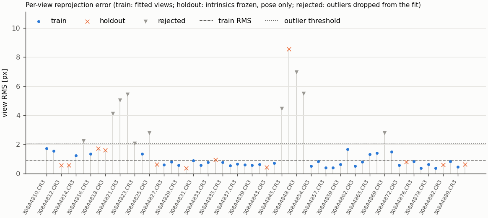
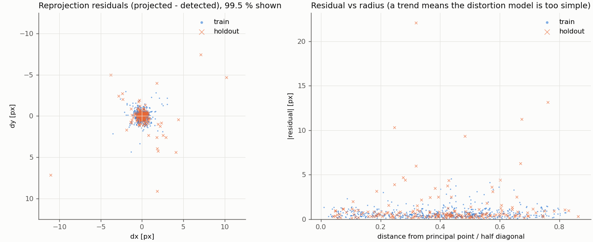
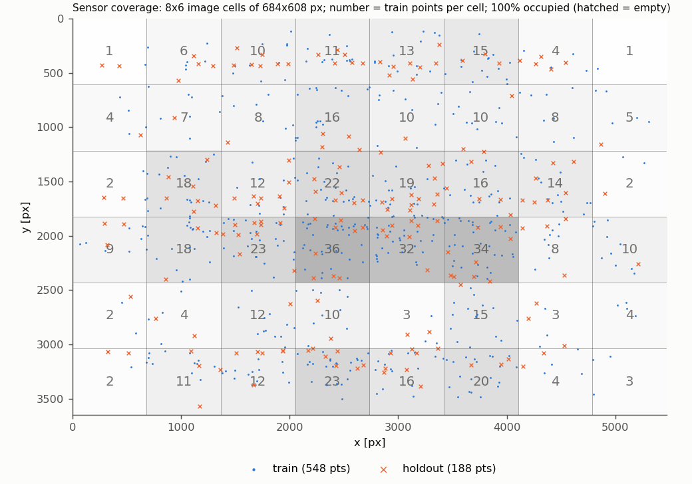
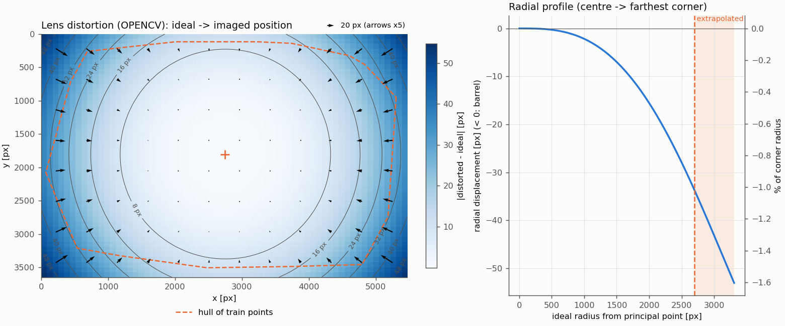

# Metric photogrammetry for medical phantoms

**Context: this study is carried out in relation to minimally invasive surgery
(MIS) and robot-assisted surgery (RAS)**, e.g. laparoscopic TAPP hernia repair
and, longer term, microsurgery on nerves.

Goal: reconstruct real objects (simple shapes first, surgical phantoms later) as
**metric 3D meshes placed in a defined reference frame**, and **quantify the
error** in shape, scale and placement. The output serves as a ground truth
(with stated uncertainty) for related research, e.g. stereo-endoscope
reconstruction, and may later be registered to CT.

Design principles:

- **Scale-agnostic**: from decimetres (TAPP: abdominal wall, inguinal region)
  down to millimetres (nerve repair, nodules). Not remote sensing.
- **Device-agnostic**: any calibrated camera (mirrorless, smartphone,
  endoscope). Cameras, lenses and targets are described in config files, never
  hard-coded.
- **Runs on CPU and GPU**: the same pipeline with presets. The CPU presets give
  lower density and resolution but run on a laptop or desktop.
- **Every result comes with an error report.** A model without a measured error
  does not count as a ground truth.

---

## 1. Why photogrammetry

Structure-from-Motion (SfM) followed by Multi-View Stereo (MVS) gives sub-mm
accuracy at almost no cost, if:

- the surface has **texture** to match,
- **scale and frame come from accurate references** (coded markers on a
  measured target, not a ruler),
- the **camera is calibrated and stays stable** (fixed focus, no
  stabilization).

| Method | Typical accuracy | Notes |
|---|---|---|
| Photogrammetry + coded targets | 0.05–0.5 mm | needs texture; our approach |
| Consumer structured light | 0.05–0.2 mm | better on low texture, less control over the frame |
| RGB-D / phone LiDAR | 1–5 mm | too coarse |
| CT | ~voxel/2 (≈0.2–0.3 mm) | sees inside; threshold-dependent surface |
| Gaussian splatting / NeRF | worse surface accuracy | not used for metric ground truth |

Known limitations:

- Only visible surfaces are reconstructed (scan parts before assembly; the
  underside is never seen).
- Glossy, translucent or uniform surfaces (silicone phantoms) need treatment:
  matte scanning spray (sublimating, AESUB-type), a speckle pattern, or
  cross-polarized lighting.
- Translucent silicone causes **subsurface scattering**, which biases depth.
  Coat it.
- **Soft phantoms deform.** Keep the phantom on one rigid base for every
  modality.

## 2. Pipeline

```
capture (RAW/TIFF or video frames)
  → [calibrate]   intrinsics per camera + lens + focus setting (target-based)
  → [sfm]         features + matching + incremental/global SfM + bundle adjustment
  → [markers]     detect coded markers, triangulate, similarity transform → reference frame
  → [dense]       MVS depth maps → fused cloud → mesh → (texture)
  → [evaluate]    shape / scale / placement errors vs reference geometry
  → [register]    (later) sphere fiducials → CT frame, FRE/TRE
```

Theory recap (step: what it does):

1. **Features and matching**: SIFT (classic) or SuperPoint + LightGlue (more
   robust on low texture).
2. **Two-view geometry**: essential/fundamental matrix + RANSAC,
   `x2ᵀ E x1 = 0`.
3. **Camera model**: pinhole + Brown–Conrady distortion (`OPENCV` /
   `FULL_OPENCV`); fisheye models for endoscopes. `x = K [R|t] X`.
4. **Bundle adjustment**: Levenberg–Marquardt on reprojection error (Ceres).
   Optionally with marker constraints.
5. **MVS**: PatchMatch on photometric consistency → depth maps → fusion →
   meshing (Delaunay / Poisson).
6. **Frame alignment**: 7-parameter similarity (Umeyama) to marker
   coordinates, with check points held out.

## 3. Tooling decisions

| Role | Choice | Why |
|---|---|---|
| Orchestration | **Python** (≥3.10), managed with **uv** | laptop 3.10, desktop and server 3.12 |
| SfM | **COLMAP via `pycolmap`** (+ optional `hloc`/LightGlue, GLOMAP) | state of the art, scriptable, SfM on CPU is fine |
| Dense / mesh / texture | **OpenMVS** | CPU *and* CUDA (COLMAP's PatchMatch is CUDA-only) |
| Calibration, markers | **OpenCV** (aruco/ChArUco, AprilTag 36h11 dictionary) | one library for both target types |
| RAW decoding | **rawpy** (LibRaw), lens corrections **off** | the calibration models the distortion |
| Mesh processing, evaluation | **Open3D / trimesh** | ICP, distances, sphere fitting |
| GUI sanity checks | COLMAP GUI, Meshroom, MeshLab, CloudCompare | inspection only |

Considered but not chosen as the core: OpenMVG (less momentum), OpenSfM (less
maintained), PyOPF and the Rust crates (too immature for a full pipeline).
Agisoft Metashape Pro remains a useful commercial cross-check, if a licence
becomes available.

### Compute presets

| Preset | Images | Dense | Mesh |
|---|---|---|---|
| `cpu-fast` | ≈2000 px long side | OpenMVS resolution-level 2, fewer views | decimated (~200k faces), no refine |
| `cpu-full` | ≈3000 px | resolution-level 1 | ~1M faces |
| `gpu-full` | full resolution | level 0, all views, RefineMesh | full |

**GPU server (RTX PRO 6000, Blackwell, sm_120, 98 GB):** prebuilt binaries
may lack sm_120 kernels. Build COLMAP/OpenMVS from source with CUDA ≥ 12.8
and `CMAKE_CUDA_ARCHITECTURES=120`, ideally in a Dockerfile.

## 4. Scene and reference frame

- **Base plate** (separate from the calibration target): rigid, flat, matte,
  carrying coded markers (ArUco/ChArUco/AprilTag) **at measured positions**.
  - Frame: origin at a chosen marker corner, X/Y in the plate plane, Z normal
    to it.
  - Add a few markers **off-plane** (a block of known height) to constrain Z
    and tilt.
  - Use 4–6+ markers spread around the object; hold 1–2 out as **check
    points**.
- **Scale**: comes from the measured marker layout, plus an independent
  **scale bar** (two targets at a measured distance) as a check.
  - **A 0.2 % scale error on 100 mm is already 0.2 mm.** Printed targets are
    often 0.1–0.5 % off. Measure or certify them.
- **Placement ground truth**: a fixture plate with holes at known positions
  and dowel pins, or reference spheres glued to the object at measured
  positions.
- **CT readiness**: 4–6 non-coplanar **ceramic or aluminium spheres** (not
  steel: streak artifacts), matte-coated, fixed to the base.
  - Fit sphere centers in both modalities.
  - Register with Arun/Horn's point-based method.
  - Report FRE (fiducial registration error) and TRE (target registration
    error).
  - CT is *not* a 0.1 mm ground truth: voxel size, partial volume and
    thresholding all add error.
- **Lighting**: diffuse and constant; cross-polarization for glossy surfaces.

## 5. Capture protocol (cm–dm scale)

- Manual everything: focus (then tape the ring), aperture, shutter, ISO, white
  balance.
- **Stabilization off**: lens IS and in-body IS (IBIS). On phones: EIS off,
  one fixed lens (no automatic lens switching), no digital zoom.
- **Stills > video.**
  - If you use video: 4K, highest bitrate, shutter ≥ 1/500 s, slow motion.
    Extract frames by spacing, and reject blurry ones (variance of the
    Laplacian).
- Object fills ~60–80 % of the frame. Shoot rings at ~15°, 40° and 65°
  elevation, plus top views, with 8–10° azimuth steps (≈100–150 images).
  Overlap ≥ 80 %.
- Alternative: a **turntable with a fixed camera**. The markers must then be
  on the turntable, and the background plain or masked.

### Current camera: Canon R6 + RF 35mm f/1.8 Macro IS STM

> **Temporary equipment.** The R6 is personal equipment, used **temporarily
> for validation** only. It will be replaced either by equivalent equipment
> purchased by our unit, or by a camera provided by the hospital we are
> likely to cooperate with (in addition to the endoscope). This is one reason
> the pipeline is device-agnostic: changing camera means adding a device
> config and recalibrating, with no code change.

- 20 MP full frame, 6.56 µm pixels, maximum magnification 0.5×.
- Work at **25–40 cm, f/8** → GSD ≈ 50–70 µm → target surface accuracy
  ≈ 0.05–0.1 mm.
- **Distortion**: the lens has strong barrel distortion that is normally
  corrected in software. Shoot RAW and decode with corrections off.
- **Focus breathing**: the focal length changes with focus. Use one
  calibration per focus setting, at the same setting as the scan.
- The smartphone (Xperia 1 III, 12 MP) is the comparison experiment: expect
  0.15–0.3 mm in photo mode and 0.3–0.5 mm in video.

## 6. Multi-scale roadmap

The math does not depend on scale; the optics do. Depth of field shrinks with
the **square of magnification**.

| Scale | Example objects | Optics | GSD | Specifics |
|---|---|---|---|---|
| 2–20 cm | TAPP organs, wall | R6 + 35 mm @ 25–40 cm | 50–70 µm | baseline |
| 0.5–3 cm | nerve segments, nodules | 0.3–1× macro | 7–20 µm | turntable, **focus stacking**, ring light + polarizers |
| < 5 mm | fine nerve structure | 1–5× macro / microscope objective | 1–5 µm | motorized stages; spray particles become visible; consider micro-CT or profilometry |

Reference for macro photogrammetry: **scAnt** (open-source insect scanner with
focus stacking, 2021).

## 7. Camera calibration

Every metric number the pipeline produces passes through the camera model.
An error in the focal length is a scale error, and an error in the distortion
bends the reconstructed surface. So each camera, lens and **focus setting** is
calibrated against a target of known geometry before it is used for a scan,
and the calibration comes with its own error report (`metrogram calibrate`,
outputs in `runs/calib/<name>/`).

### 7.1 Targets

**How to choose a target type:**

| Type | Feature | For | Against |
|---|---|---|---|
| Checkerboard | saddle points (X-corners) | very precise corners, insensitive to blur and exposure | the whole board must be visible, so the image corners are hard to cover |
| Circle grid | ellipse centres | precise on sharp images | perspective and distortion shift the ellipse centre (bias); the whole board must be visible |
| **ChArUco** | checkerboard saddle points + ArUco IDs | saddle-point precision **and** partial views (each corner is identified) | needs a well-printed, certified board |
| **AprilGrid** (Kalibr) | corners of AprilTag squares | partial views, robust IDs, Kalibr-compatible | a corner of a black square moves with blur and exposure (an edge is grey over a few px; its threshold sets where the corner lands) |

Partial views matter: the image **corners** must be covered, where the
distortion is largest, and a board that must be seen entirely cannot reach
them. That rules out checkerboards and circle grids here. Between the two
coded types, ChArUco is preferred for the final measurements, because its
saddle points do not move with blur. AprilGrid is what we have now.

**What makes a target usable for metrology:**

- **Known dimensions**: printed targets are often 0.1–0.5 % off, and every
  % of scale error in the target becomes a % of focal-length error in the
  camera. Use a certified board or measure it (caliper or a flatbed scan).
- **Flat and rigid**: glass, ceramic, aluminium composite. Acrylic bends
  and expands (~70 µm/m/K: 5 K × 30 cm ≈ 0.1 mm).
- **Matte**: no specular highlights (endoscope lights are coaxial).
- **The right size for the scale**: see §7.5. The board should cover
  50–100 % of the field of view at the working distance.

**Available now:** Kalibr-style AprilGrid printed on acrylic in Taiwan
(not certified).

- 6×6 tags, family 36h11, **tag 50.0 mm, gap 10.0 mm** (`tagSpacing` 0.2,
  pitch 60 mm), extent 350 mm. The printed caption reads "6x6 tags,
  size=5.0cm and spacing=1.0cm". A calibration sweep on R6 data confirms it:
  the error is minimal at 50.0 mm and 6× larger at 49.5 or 50.5 mm.
  - The values used before 2026-11-17 (43.13 mm, ratio 0.391) were wrong.
    They came from the second error below.
- **Kalibr tags have a 2-bit black border** (10×10 bits), while OpenCV
  assumes 1 bit. Configure `border_bits: 2` in the target YAML.
- Board frame: origin at the outer bottom-left corner of tag 0 (caption at
  the bottom), x right, y up, z out of the board.
- **To do:** caliper check of the outer extent (350 mm) to certify the scale.

**Requested** (if budget allows):

| Target | For | Spec |
|---|---|---|
| A | R6 at the dm scale | ChArUco, ~A4, 12–15 mm squares, matte, glass or aluminium composite, **certified dimension report** |
| B | stereo endoscope | ChArUco, ~80–120 mm, 3–5 mm squares, **matte non-glass** (coaxial light glare), rigid |
| C (later) | macro/nerve scale | chrome-on-glass or ceramic, lithographic, 0.5–1 mm squares |

Endoscopes need fisheye models (`equidistant` / Kannala–Brandt) and good
coverage of the image corners.

### 7.2 Camera model and fitting

**Projection.** A board point $\mathbf X_j$ (metres, board frame) seen in
view $i$ is first moved into the camera frame by the board pose
$(R_i, \mathbf t_i)$, then normalised by depth:

```math
\begin{pmatrix} X_c \\ Y_c \\ Z_c \end{pmatrix} = R_i \mathbf X_j + \mathbf t_i,
\qquad x = X_c / Z_c, \quad y = Y_c / Z_c .
```

**Distortion** (`OPENCV` model, Brown–Conrady, $r^2 = x^2 + y^2$):

```math
\begin{aligned}
x_d &= x\,(1 + k_1 r^2 + k_2 r^4) + 2 p_1 x y + p_2 (r^2 + 2x^2) \\
y_d &= y\,(1 + k_1 r^2 + k_2 r^4) + p_1 (r^2 + 2y^2) + 2 p_2 x y
\end{aligned}
```

$k_1, k_2$ are radial (barrel when the displacement is inward) and
$p_1, p_2$ tangential (lens decentring). **Pixels:**

```math
u = f_x\, x_d + c_x, \qquad v = f_y\, y_d + c_y .
```

$f_x, f_y$ are the focal length in pixels ($f / p$, lens focal length over
pixel pitch, at the current focus) and $(c_x, c_y)$ is the principal point.
Together: $\hat{\mathbf u}_{ij} = \pi(\boldsymbol\theta;\, R_i, \mathbf t_i, \mathbf X_j)$
with intrinsics $\boldsymbol\theta = (f_x, f_y, c_x, c_y, k_1, k_2, p_1, p_2)$.

**Fit.** With $\mathbf u_{ij}$ the detected corner, the residual is
$\mathbf e_{ij} = \hat{\mathbf u}_{ij} - \mathbf u_{ij}$ (pixels), and
calibration solves

```math
\min_{\boldsymbol\theta,\ \{R_i, \mathbf t_i\}} \ \sum_{i \in \text{train}} \sum_j \lVert \mathbf e_{ij} \rVert^2
```

by Levenberg–Marquardt (OpenCV `calibrateCameraExtended`, initialised with
Zhang's closed form from the board homographies). The error measure is the
**RMS reprojection error**:

```math
\text{RMS} = \sqrt{\frac{1}{N} \sum_{i,j} \lVert \mathbf e_{ij} \rVert^2 } \quad [\text{px}],
```

with $N$ the number of points. It is the typical distance between where the
model says a corner should be and where the detector found it. The `±`
values in the report are one standard deviation of each parameter, from the
inverse of $J^\top J$ ($J$ the Jacobian) scaled by the residual variance.
They describe the noise only, not systematic errors (wrong board size,
moved focus).

**What `calibrate` does around the fit:**

1. **Detect** the board in every frame. AprilGrid detection runs on a copy
   downscaled to ≤ 2000 px; each corner is then refined at full resolution
   (edge lines fitted on the middle 60 % of each tag side, intersected, then
   a small `cornerSubPix`).
2. **Blur filter** (per tag): the detector measures the width of each tag's
   edges,
   ```math
   w = \frac{I_{95} - I_{5}}{\max_s |\partial I / \partial s|} \quad [\text{px}],
   ```
   i.e. the width of a linear ramp with the same height ($I_{95} - I_5$,
   intensity percentiles across the edge) and the same maximum slope. A sharp
   edge is about 1.5–2 px wide. Points with
   $w > \max(3\ \text{px},\ 2 \times \text{median of the scan})$ are dropped
   (`--blur-floor-px`, `--blur-rel`; 0 turns the filter off).
3. **Select** views: at least `--min-points` corners, sharp enough, then
   farthest-point sampling on a pose descriptor (position, size and tilt of
   the board in the image) so the views are diverse.
4. **Split**: a random 20 % of the selected views become **holdout** views
   (§7.3), the rest are **train** views.
5. **Fit with outlier rounds**: fit, then drop the views whose RMS exceeds
   3 × the median view RMS (at most 10 % per round, worst first), and refit.
   Dropped views are marked **rejected**.
6. **Validate** on the holdout views, write `calibration.yaml` (COLMAP and
   OpenCV parameters), `camchain_kalibr.yaml`, `report.json` (per-view data)
   and the plots (§7.4).

### 7.3 Holdout validation

**In plain words.** The fit adjusts the parameters until the model matches
the training images as well as possible. A low training error therefore says
little: a model with enough freedom can also fit noise and detection errors
(overfitting). The honest test is images the fit **never saw**: freeze the
camera model, and check whether it explains them as well. It is the
difference between grading a student on the exercises they practised and on
a new exam.

**Technically.** For each holdout view $h$, the intrinsics
$\hat{\boldsymbol\theta}$ from the train fit are **frozen**. Only the board
pose of that view is unknown (6 parameters: the board is somewhere in front
of the camera). It is estimated from that view's own points,

```math
(\hat R_h, \hat{\mathbf t}_h) = \arg\min_{R,\mathbf t} \sum_j \lVert \pi(\hat{\boldsymbol\theta}; R, \mathbf t, \mathbf X_j) - \mathbf u_{hj} \rVert^2 ,
```

with `solvePnP` (IPPE, exact for planar targets) followed by LM refinement.
The residuals after this pose-only fit are the **holdout residuals**. A pose
cannot hide an error in the intrinsics: a wrong focal length or distortion
leaves a pattern in the residuals that no rigid motion of the board removes.
Pose-only fitting absorbs 6 degrees of freedom per view, so a holdout view
with many points is a strong test.

**What to expect.** With a correct model and detection noise $\sigma$ per
coordinate, the train RMS is slightly **optimistic**: the fitted parameters
absorb a little of the noise, $E[\text{RMS}^2_\text{train}] \approx 2\sigma^2 (1 - P/2N)$
for $P$ fitted parameters. The holdout RMS should then be about the same as
the train RMS, or slightly larger. Clearly larger means:

- the intrinsics changed between images (focus ring moved, autofocus, IS or
  IBIS on, a zoom), or
- the model overfits (too many distortion terms for the coverage), or
- a few holdout images are bad (blur, a wrong corner).

**Robust statistics.** RMS squares the errors, so one bad image dominates
it: a single 8 px view among eleven 0.6 px views gives a plain RMS of
about 2.4 px (equal point counts). To separate "the model does not
generalise" from "a few bad images", the report (`errors.train`, `errors.holdout` in `calibration.yaml`)
also gives:

| Field | Meaning |
|---|---|
| `view_rms_median_px`, `view_rms_p90_px` | median and 90th percentile of the per-view RMS |
| `point_err_median_px`, `point_err_p95_px` | median and 95th percentile of the per-point error $\lVert \mathbf e \rVert$ |
| `core_threshold_px` | 3 × the median train view RMS: the same outlier rule as in training |
| `core_rms_px` | RMS over the views at or below that threshold |
| `outlier_views` | the views above it, by file name |

The **core RMS** is the number to compare with the train RMS: both exclude
outlier views by the same rule. `calibrate` warns about unstable intrinsics
only when the holdout core RMS or median view exceeds 1.5 × the train
value, and lists bad holdout views separately.

### 7.4 Reading the plots (R6, 20 cm set)

Canon R6 + RF 35 mm, MF at ~20 cm, f/8, `OPENCV` model, `--min-points 12`.

| Set | $f_x = f_y$ [px] | train RMS | holdout core RMS | holdout median view | bad holdout views | blur filter |
|---|---|---|---|---|---|---|
| 20 cm | 5859.5 | 0.91 px | **0.91 px** | 0.63 px | 1 / 12 | 5.2 % of points |
| 30 cm | 5743.5 | 1.66 px | **1.28 px** | 1.06 px | 2 / 12 | 3.6 % of points |

The holdout core RMS is no larger than the train RMS: the intrinsics
generalise. The focal length differs by 2 % between the two focus settings
(focus breathing), hence one calibration per focus setting. The plain
holdout RMS (2.6 and 3.0 px) is driven by the 1–2 bad views. They are not
blurrier than the others; steep obliquity is suspected (open).

Marker shapes code the view status in all plots: **dot = train**,
**× = holdout**, **▼ = rejected** (colour repeats it).

**Per-view error.** One marker per view: its RMS after the fit (train) or
after the pose-only fit (holdout). Rejected views are the ones dropped by
the outlier rounds; they are shown with their RMS at the time they were
dropped. Dashed line: train RMS; dotted line: outlier threshold (3 × the
median train view).



**Residuals.** Left: every residual vector $(\Delta u, \Delta v)$, projected
minus detected. A round cloud centred on zero means noise only; an
elongated or offset cloud means a systematic error. Right: residual size
against the distance from the principal point. A rising trend towards the
edge means the distortion model is too simple (try `FULL_OPENCV`). Here it
is flat; the few large points are the bad views.



**Coverage.** The sensor (not the board) is cut into 8 × 6 equal **image
cells** of 684 × 608 px. The cells have nothing to do with the 60 mm board
pitch. The number in each cell is the count of **train** points that fall in
it, summed over all train views; holdout points are plotted but not counted.
A cell is occupied if it holds at least one point, and the title gives the
fraction of occupied cells. Why it matters: the distortion is only
constrained where there are points, and it is strongest in the image
corners. An empty cell (hatched) means the model is extrapolated there, and
`calibrate` warns if fewer than 75 % of the cells or any corner cell are
empty. At 20 cm the board overfills the frame (about 190 × 125 mm visible),
so each view holds only 4–9 tags (≈ 15 points); together the views still
cover the whole sensor.



**Lens distortion.** What the fitted model does to the image, **in sensor
pixels**. For a point imaged by an ideal pinhole camera with the same
$f_x, f_y, c_x, c_y$, the arrow goes from that ideal position to where the
real lens puts it. Arrows are magnified (the key gives the gain and a
reference length); the colour map and contours give the true displacement.
Here it is barrel distortion: points are pulled toward the centre, by about
50 px in the corners. The orange **dashed line** is the convex hull of all
train points. Inside it the model is fitted to data; outside it, it is
extrapolated. Right: the radial profile from the principal point (+) to the
farthest corner, in px and in % of the corner radius; the shaded part is
beyond the farthest train point.



The 30 cm plots are in `runs/calib/r6_calib_30cm_opencv/`.

### 7.5 Ground sampling distance (GSD) and scale

**GSD** is the size of one pixel projected onto the object, at distance $Z$
from the camera's projection centre:

```math
\text{GSD} = \frac{Z\, p}{f} = \frac{Z}{f_x} ,
```

with $p$ the pixel pitch, $f$ the focal length, and $f_x = f/p$ the focal
length in pixels from the calibration (use the calibrated value: it includes
focus breathing). Every error in pixels converts to object space through
it: a 0.6 px residual at GSD 52 µm is about 30 µm on the board.

R6 + RF 35 mm ($p$ = 6.56 µm, $f_x$ ≈ 5740–5860 px):

| $Z$ | GSD | field of view (5472 × 3648 px) |
|---|---|---|
| 20 cm | ≈ 34 µm | ≈ 190 × 125 mm |
| 30 cm | ≈ 52 µm | ≈ 285 × 190 mm |
| 40 cm | ≈ 70 µm | ≈ 380 × 255 mm |

**Comparing imaging devices.** To compare two cameras fairly, image the same
scene at the **same GSD**, not from the same distance, so that both sample
the object equally finely. Then compare errors in **object units** (µm),
not in pixels: a 0.5 px error is not the same thing on two sensors. Device
B matches device A when

```math
Z_B = Z_A\, \frac{f_{x,B}}{f_{x,A}} .
```

Example: Pentax K-3 Mark III Monochrome (6192 × 4128 px, $p$ ≈ 3.76 µm) with
a 100 mm macro: $f_x$ ≈ 100 / 0.00376 ≈ 26 600 px, i.e. 4.6 × the R6 + 35 mm.

| R6 at | K-3 Mono + 100 mm at | GSD |
|---|---|---|
| 20 cm | ≈ 0.93 m | ≈ 34 µm |
| 30 cm | ≈ 1.39 m | ≈ 52 µm |
| 40 cm | ≈ 1.85 m | ≈ 70 µm |

The pixel counts are similar, so the field of view is similar too. These
distances come from the nominal focal length. Calibrate the second camera
at its own working distance, then correct $Z_B$ with its calibrated $f_x$.
Other differences to keep in mind:

- A monochrome sensor has no Bayer filter and no demosaicing, so it is
  sharper per pixel than a colour sensor with the same pitch.
- At equal GSD, a longer lens from farther away gives a **narrower
  baseline** between views for the same camera motion (less depth
  precision per view pair) but more depth of field. Keep the **angles**
  between views the same, not the distance moved.
- Keep the rest equal: same scene, same number of images, same exposure
  strategy, same pipeline settings.

**Scale of the phantom.** The calibration must match the scan:

- **Same focus setting and distance** as the scan (focus breathing changes
  $f_x$ by ~2 % between 20 and 30 cm on the R6 + 35 mm).
- **Target size ≈ field of view.** If the board is much larger than the
  frame (R6 at 20 cm: 350 mm board, 190 mm field), each view sees few tags;
  if it is much smaller, the image corners are never covered. Smaller scenes
  need smaller targets (targets B and C).
- **Tags large enough in pixels**: ≥ ~30 px per tag side to decode reliably,
  more for precise corners. Tags hundreds of px wide are handled by the
  downscaled detection.
- **Depth of field**: the board is tilted in many views, so it must stay
  sharp over its whole depth. Depth of field shrinks with the square of the
  magnification (§6): at close range, stop down (f/8–f/11 on the R6) and
  check the edge-width numbers in `report.json`.
- **What GSD buys**: corner detection reaches ~0.1–0.3 px on good images, and
  dense surfaces typically land at 1–2 GSD. For a TAPP phantom (dm scale)
  a 50–70 µm GSD is ample; nerve-scale work needs 5–20 µm (macro optics,
  target C).

## 8. Evaluation (what "accurate" means here)

Report separately:

- **Shape**: best-fit reference geometry (ICP/least squares) → cloud-to-model
  distances (mean, RMS, P95, max) + a deviation heatmap.
- **Scale**: the fitted scale factor's deviation from 1, plus the scale bar
  check.
- **Placement**: fitted pose vs fixture pose (mm, degrees); marker
  check-point errors.
- **Repeatability**: repeat scans of the same object.

Phase-1 reference objects:

- precision ceramic balls (µm-level diameter tolerance),
- a machined block or gauge blocks,
- 3D-printed platonic solids (**measured** with calipers, not taken from
  CAD).

## 9. Roadmap

0. **Repo + environment** (uv, Python ≥3.10), config schema for devices,
   targets and presets.
1. **Calibration** (`calibrate`) ✅: AprilGrid now, ChArUco later.
   - RAW → linear TIFF.
   - Export to COLMAP / Kalibr formats.
   - Report: reprojection error, coverage heatmap, parameter uncertainty.
2. **SfM** (`sfm`) with known intrinsics ✅, **markers / metric frame**
   (`markers`) ✅.
   - Synthetic check: cameras around a textured 10 cm cube recovered to
     ≤ 69 µm (mean 34 µm) at a 0.45 m radius.
   - Video smoke test: 120/120 frames registered, 0.85 px mean reprojection
     error (EIS video).
   - Markers, synthetic: check points 0.10 mm RMS (the tag-corner detection
     floor), check-point scale within 36 ppm.
   - Markers, phone video (EIS on, 1080p): check points 0.64 mm RMS (0.30 mm
     in-plane, 0.56 mm out-of-plane), 400 mm distance off by 0.22 mm.
     **Invalid**: obtained with the wrong target dimensions and tag border
     (§7.1); to be re-run.
3. **Dense** (`dense`) with OpenMVS ✅ (CPU; GPU build on the server pending).
   - Synthetic: 80 mm cube top at 80.09 mm; board plane RMS 0.18 mm, tilt
     0.003°, offset +0.30 mm (open item: small systematic upward bias of the
     board in the dense cloud, ~0.5 px).
   - Outputs: `dense_points.ply`, `mesh.ply`, `textured/mesh_textured.ply`
     (+ PNG atlas; OBJ copy in `textured/obj/`), `dense_report.json`.
4. **Evaluation** (`evaluate`) on simple shapes.
5. Phantom (TAPP), coating and lighting study.
6. CT registration (`register`).
7. Smaller scales: focus stacking, macro rigs; endoscope camera frame
   registration.

## 10. Working across machines

| Machine | Python | Role |
|---|---|---|
| laptop | 3.10.2 | development, small CPU runs |
| desktop | 3.12.3 | CPU runs |
| GPU server (RTX PRO 6000) | 3.12.3 | full-resolution runs |

Code is shared through git. Project knowledge for Claude Code lives in
`CLAUDE.md` (committed), so a Claude Code session on any machine starts with
the same context.

## 11. Development quick start

```sh
uv sync                          # base deps (+ dev group: pytest, ruff)
uv sync --extra sfm --extra eval # later stages: pycolmap, open3d, trimesh
uv run metrogram check-config configs/*/*.yaml
PYTHONPATH= uv run pytest -q

# calibration (video, image dir or RAW dir); outputs in runs/calib/<name>/
uv run metrogram calibrate data/raw/xperia1m3_aprilgrid_eis.mp4 \
    -t configs/targets/aprilgrid_6x6_acrylic.yaml \
    -d configs/devices/xperia_1_iii_main.yaml --focus-note "AF, EIS on" --save-frames

# frames from a video, then sparse reconstruction (arbitrary scale/frame)
uv run metrogram extract-frames data/raw/xperia1m3_aprilgrid_eis.mp4 -n 120
uv run metrogram sfm data/frames/xperia1m3_aprilgrid_eis \
    -c runs/calib/xperia1m3_aprilgrid_eis_opencv/calibration.yaml \
    -p configs/presets/cpu-fast.yaml --matcher sequential

# metric scale + board frame; PLYs for any viewer (metres, board frame)
uv run metrogram markers runs/sfm/xperia1m3_aprilgrid_eis_cpu-fast \
    -t configs/targets/aprilgrid_6x6_acrylic.yaml
```

Outputs of `markers` (in `<sfm run>/markers/`):

| File | Content |
|---|---|
| `points_metric.ply` | sparse point cloud, colored, board frame, metres |
| `cameras.ply` | camera frustums (mesh; a tick marks the image top) |
| `board_frame.ply` | board outline + axes (x red, y green, z blue) |
| `markers.ply` | triangulated target points (blue control, orange check, gray rejected) |
| `sparse_metric/` | COLMAP model in the board frame (metres) |
| `markers_report.json`, `markers.png` | alignment, errors, scale check, per-point data |

```sh
# look at results: Z-up turntable PNGs in <dir>/views/, or --show (interactive)
uv run metrogram view runs/sfm/xperia1m3_aprilgrid_eis_cpu-fast/markers --views 6
uv run metrogram view runs/sfm/xperia1m3_aprilgrid_eis_cpu-fast/markers --show

# dense cloud + mesh + texture (OpenMVS), metric, board frame
uv run metrogram dense runs/sfm/xperia1m3_aprilgrid_eis_cpu-fast/markers -p configs/presets/cpu-fast.yaml
uv run metrogram view runs/sfm/xperia1m3_aprilgrid_eis_cpu-fast/dense_cpu-fast/mesh.ply \
    runs/sfm/xperia1m3_aprilgrid_eis_cpu-fast/markers

# OpenMVS (dense stage): CPU build here, CUDA on the server (see script header)
scripts/build_openmvs.sh                    # v2.3.0 -> ~/opt/openmvs/bin/OpenMVS (no sudo)
scripts/build_openmvs.sh --cuda --arch 120  # RTX PRO 6000 (Blackwell)
```

```sh
uv run ruff check . && uv run ruff format .
```

- Package: `metrogram` (`src/metrogram/`), CLI `metrogram <subcommand>`.
- Configs: `configs/devices/`, `configs/targets/`, `configs/presets/`. Each
  YAML file has a `kind`. Lengths are in metres, with the unit in the key name.
  Unknown keys are rejected.
- No `.python-version` is pinned: each machine uses its own interpreter
  (3.10 laptop, 3.12 desktop/server) against the same `uv.lock`.
- **ROS note:** a sourced ROS Humble puts `/opt/ros/...` on `PYTHONPATH`. Its
  pytest plugins then break test collection, and its packages can shadow the
  venv's. Clear it for this project (`PYTHONPATH= uv run ...`), or use an
  alias such as `alias uvr='PYTHONPATH= uv run'`.
